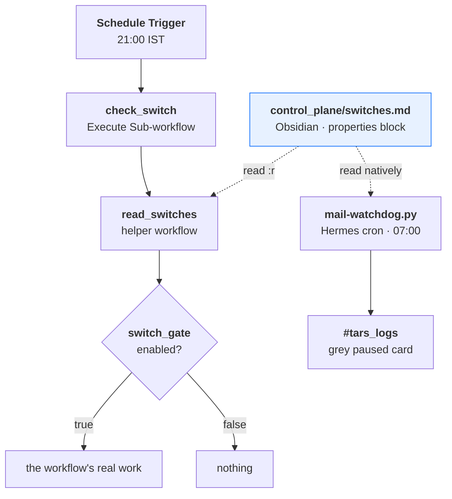

# control_plane

One markdown file in the Obsidian vault decides whether a scheduled workflow runs tonight. Tick a checkbox and it
runs; untick it and it skips, quietly, without the watchdog mistaking a deliberate pause for a dead workflow.

It is the first thing in this repository that both n8n and Hermes read.

## Why it exists

`README.md` and `PLAN.md` have described `control_plane/` as the control surface since the beginning — *you command
from `control_plane`, n8n reports into `dashboard`, and each folder has exactly one writer*. The folder was mounted
`:ro`, documented in three places, and **empty**. The only workflow that read it pointed at
`/vault/control_plane/services.md`, a file deleted after an early test.

So in practice there was no off switch. Pausing `mail_label_draft` meant deactivating it in the n8n UI, which also
discards the schedule — and it had to be done by hand before a flight, from memory, with nothing recording that it
happened.

## The file

`control_plane/switches.md`. One property per scheduled workflow:

```markdown
---
mail_label_draft: true
---
```

Obsidian's **Properties** core plugin renders a boolean property as a real checkbox at the top of the note, so the
control surface is a tick box rather than text to edit. The body of the note holds a foldable callout per switch
explaining what pausing it costs. Nothing in the body is ever parsed, which is why those notes can say anything.

A property name must match its n8n workflow name exactly.

The note carries a second `---` immediately after the properties block, which Obsidian renders as a divider. The
parser's regex is non-greedy and stops at the first closing `---`, so it never sees it. Worth knowing if the Code
node is ever swapped for a real YAML library, which would read that as a second document.

## Flow



Two readers, one file, and they reach it by different routes. n8n reads `/vault/control_plane/switches.md` through
the read-only bind mount. Hermes runs natively on the Mac and reads the same file at its real path, since it is not
in the container at all.

Neither can write it. `:ro` stops n8n at the filesystem level; the watchdog only ever opens it for reading.

## `read_switches` — the helper workflow

Four nodes, no credential, no model:

```
When Executed by Another Workflow → Read/Write Files from Disk → Extract from File → Get Contents
```

| Node | Setting |
|---|---|
| trigger | input source **Define using fields below**, one field: `workflow` (string) |
| Read/Write Files from Disk | `/vault/control_plane/switches.md`, On Error → **Continue** |
| Extract from File | operation `Text`, On Error → **Continue** |
| Get Contents | parses the properties block, answers one question |

It takes a workflow name and returns a single boolean:

```json
{ "workflow": "mail_label_draft", "enabled": true }
```

**The trigger must declare the `workflow` field.** On `passthrough` the sub-workflow receives whatever the caller
sends, and a Schedule Trigger sends `{ timestamp, "Readable date" }` with no `workflow` in it — so the lookup would
read `undefined`, every answer would be `enabled: true`, and the gate would be permanently open with nothing to show
for it. A declared field gives the caller a labelled box instead.

## Fail open, and why

A missing, renamed or unreadable file means **everything runs**.

Three deliberate choices produce that, and removing any one of them breaks it:

| Where | What it does |
|---|---|
| `Read/Write Files from Disk` → On Error: Continue | a miss becomes `{"error": "No file(s) found"}` instead of stopping the run |
| `Extract from File` → On Error: Continue | passes that item along rather than failing on the absent binary |
| `?? ''` in `Get Contents` | an absent `data` field becomes an empty string instead of throwing on `undefined.match` |

`Read/Write Files from Disk` never returns zero items — a pattern matching nothing is reported as an error item, so
there is no empty list to branch on. **"Continue"** is the plain option; **"Continue (using error output)"** sends
the failure down a second output that nothing is wired to, where it is silently discarded and the whole chain stops
without saying so.

The reasoning is about which failure is worse:

| | What happens | How you find out |
|---|---|---|
| Fail open, wrongly | runs when you wanted it paused | immediately — labels appear, Slack card posts |
| Fail closed, wrongly | silently does nothing | silence, for up to a day |

Silence is the failure this repository keeps being bitten by — three nights of unlabelled mail after an Ollama
upgrade, a sleeping Mac on 2026-10-22. And an unwanted run of `mail_label_draft` is cheap, because it only applies
labels and writes drafts; nothing is archived, deleted or sent.

**That reasoning does not transfer.** A workflow that archives mail, deletes files, sends messages or spends money
should fail closed. One character in the helper's last line:

```python
enabled: switches[asked] !== false   // fail open  — anything but an explicit false runs
enabled: switches[asked] === true    // fail closed — only an explicit true runs
```

Make it a per-workflow decision, not a default that gets inherited.

## Wiring a workflow

Two nodes between the trigger and the first real step:

| Node | Setting |
|---|---|
| `check_switch` — Execute Sub-workflow | target `read_switches`, `workflow` = this workflow's name, Wait for Completion on |
| `switch_gate` — IF | `{{ $json.enabled }}` Boolean → is true |

True continues; false is left unconnected. An unconnected false branch is correct here — paused means there is
genuinely nothing to do, and the execution ends green. That is different from an unconnected **error** output, which
hides a failure.

Measured on `mail_label_draft`: a gated run ends in **146 ms** against roughly seven minutes for a full one, and the
gate itself costs about 40 ms.

## The watchdog side

Without this, unticking a box earns an amber **stale** card every morning, because `mail-watchdog.py` only sees how
long it has been since the last execution and cannot tell a pause from a death.

`switch_enabled()` in `n8n_check.py` reads the same file natively and the watchdog answers before touching n8n:

```python
if not switch_enabled(NAME):
    send_card(LOGS, GREY, f":zzz: *{NAME}* — paused", ...)
    raise SystemExit
```

| State | Colour | Channel |
|---|---|---|
| healthy | green | `#tars_logs` |
| paused | grey | `#tars_logs` |
| stale | amber | `#tars_alerts` |
| failed / never ran | red | `#tars_alerts` |

Still exactly one card a day, so **nothing in either channel still means the watchdog itself did not run**.

It exits before calling the n8n API on purpose. Pausing the mail and shutting Docker down for a trip is one action in
practice, and the pair should produce a quiet grey card rather than a connection-refused failure every morning.
`raise SystemExit` exits `0`, so Hermes does not record it as a failed job.

`switch_enabled()` is the only `try`/`except` in these scripts, against the no-error-handling rule in
[`mail_watchdog.md`](mail_watchdog.md). It is not hiding a failure — an unreadable file **is** the fail-open answer,
the same rule the n8n side implements with two On Error settings.

## Verifying it

```bash
# the helper, in n8n: pin { "workflow": "mail_label_draft" } on the trigger and run
# the watchdog, from a shell
hermes cron run f8c760a9a8f4
```

| Vault state | `read_switches` | `mail_label_draft` | watchdog |
|---|---|---|---|
| ticked | `enabled: true` | runs | green card |
| unticked | `enabled: false` | stops at `switch_gate`, green, 146 ms | grey paused card |
| file renamed away | `enabled: true` | runs | green card |
| unknown switch name | `enabled: true` | runs | — |

The third row is the one worth repeating after any change. It is the only test that proves fail-open still works, and
the two On Error settings are easy to lose.

## What this does not do

| Gap | Note |
|---|---|
| Ticking back on can still raise one false alarm | The watchdog reads `startedAt` and nothing else. Pause for three days, tick back on after 21:00, and the next morning's card is amber *stale* — correct, but you already know why. It clears itself the following day. Tick back on before 21:00 to avoid it |
| One workflow uses it | `mail_label_draft` only. Each new caller costs two nodes and one property |
| Not a stop button | A run already in flight finishes. Unticking takes effect at the next scheduled run |
| Hermes cannot flip a switch | Writing the file from `#tars_chat` would break the one-writer-per-folder rule the vault mounts are built on. A deliberate omission, not an oversight |
| No record of why | The file says a workflow is paused, never since when or what for. Git history of the vault is the only trail |
