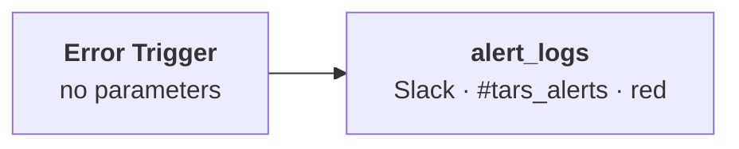

# error_handler

One workflow that fires whenever any other workflow fails, and posts a red card to `#tars_alerts`. It is set as the
Error Workflow on every production workflow in this repository.

Two nodes. It is the smallest workflow here and the one with the widest reach.

## Why it exists

Before this, a failed execution left no trace outside n8n's own execution list. A scheduled workflow that died at
03:00 stayed dead until somebody opened the UI and noticed. The failure that prompted it:

```
Problem in node 'history_lookup'
The connection to the server was closed unexpectedly, perhaps it is offline.
```

Gmail dropped a connection, the run died at the first node, and nothing was labelled that cycle. Nothing said so.

## Flow



## The Error Trigger

It takes no configuration. n8n calls the nominated Error Workflow after an execution fails, passing the failure
details as the trigger's output:

```json
{
  "execution": {
    "id": "231",
    "url": "http://localhost:5678/execution/workflow/1/231",
    "retryOf": "34",
    "error": { "message": "…", "stack": "…" },
    "lastNodeExecuted": "history_lookup",
    "mode": "trigger"
  },
  "workflow": { "id": "tCzqvauu1uCOzt8O", "name": "mail_label_draft" }
}
```

Executing the workflow by hand injects n8n's own sample values — `Example Workflow`, `Node With Error`, execution
`231`. That is how the card was built and tested without breaking anything real.

## The card

Four facts, chosen because they are what you need before deciding whether to care:

| Field | Source | Why |
|---|---|---|
| Workflow | `workflow.name` | which one died |
| Failed at | `execution.lastNodeExecuted` | the node that threw |
| Error | `execution.error.message` | n8n's message, verbatim |
| Link | `execution.url` | straight to that execution, red node visible |

Every expression is written defensively — `$json.execution?.error?.message ?? 'no message'`. An unexpected payload
shape produces a card saying `unknown`, not a second failure inside the error handler.

The error text is wrapped in `JSON.stringify(...).slice(1,-1)` so quotes inside it cannot break the Block Kit JSON.
Same technique as the memory workflows.

## Which workflows point at it

Set under **Settings → Error Workflow** on each:

```
mail_label_draft      memory_write
mail_categorizer      memory_read
                      memory_agent
```

`error_handler` deliberately does **not** point at itself. An error handler that errors would call itself, and that
loop has no exit.

## What it does and does not catch

**Catches:** anything that fails an execution and is not handled inside the workflow — a Code node throwing, Ollama
unreachable, a sub-workflow erroring, an expression referencing a node that did not run.

**Does not catch:** a node set to `Continue (using error output)`. That node routes its failure down a second wire
instead of failing the execution, so from n8n's point of view nothing went wrong. Those failures are reported by the
workflow's own Slack card instead.

In `mail_label_draft` five nodes work that way — `history_lookup`, `fetch_mail`, `mail_categorizer`, `apply_labels`
and `create_draft` — and their failures land in `#tars_alerts` via that workflow's `error_logs` node, not via this
one.

**Retries run first.** The Gmail nodes retry three times at two-second intervals, so a card means three consecutive
failures, not one bad response. The connection error above would most likely never have produced one.

## One duplicate worth expecting

If `mail_categorizer` fails internally you get two alerts: its own execution fails, so this workflow fires, **and**
the calling node in `mail_label_draft` routes to that workflow's `error_logs`.

Not a bug. One card names the sub-workflow, the other names the caller, and knowing which layer failed is worth a
duplicate.

## What this does not do

| Gap | Note |
|---|---|
| No severity levels | Every failure is red. A retry-exhausted Gmail blip and a broken credential look identical |
| No deduplication | A workflow failing on every run posts on every run |
| No recovery | It reports. Anything that should keep running past a failure needs a per-node error output instead |
