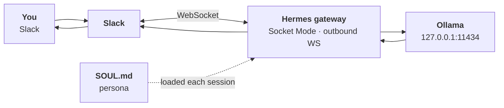

# hermes_gateway

The conversational half of T.A.R.S. A Hermes Agent gateway running natively on the Mac, reachable from Slack, with a
persona file and a local model behind it.

Nothing here lives in n8n or Docker. n8n runs the scheduled work; this is the part you talk to.

## Why Slack, and why Socket Mode

The original plan was Telegram. It stalled on one problem: a bot needs a public HTTPS endpoint for webhooks, and this
machine has no stable public address. The options were a tunnel to maintain or a cloud host to pay for.

**Slack Socket Mode removes the requirement entirely.** The gateway opens an outbound WebSocket to Slack and receives
events over it. No inbound port, no public URL, no tunnel, no reverse proxy. The same reasoning that keeps n8n bound
to `127.0.0.1` applies here — nothing on this machine should be reachable from outside it.

The cost is a second token. Socket Mode needs both:

| Token | Prefix | Purpose |
|---|---|---|
| Bot token | `xoxb-` | acting as the bot — reading channels, posting |
| App-level token | `xapp-` | opening the WebSocket. Needs the `connections:write` scope |

Both live in `~/.hermes/.env` as `SLACK_BOT_TOKEN` and `SLACK_APP_TOKEN`. An app-level token without
`connections:write` fails at connect time, which is the usual first-run mistake.

## Flow



## The two surfaces

Slack is reached two ways, and they behave differently:

| Surface | Config | Behaviour |
|---|---|---|
| Home channel | `platforms.slack.home_channel.chat_id` — a DM | where Hermes sends unprompted messages, such as restart notices |
| `#tars_chat` | `platforms.slack.extra.free_response_channels` | a public channel where the bot answers **without** being @-mentioned |

```yaml
platforms:
    slack:
        enabled: true
        extra:
            free_response_channels:
                - C0CBC5F3P33          # #tars_chat
            reply_in_thread: false
        home_channel:
            chat_id: D0CC3QLLN1W       # DM
            platform: slack
```

`free_response_channels` is the setting that makes `#tars_chat` feel like a conversation rather than a command line.
In any other channel the bot stays silent unless addressed. Adding a busy channel to that list would make it reply to
everything said in it.

`reply_in_thread: false` keeps answers in the channel instead of threading them. Suits a single-user channel; worth
flipping if anyone else joins.

## Who may talk to it

```yaml
gateway:
    allow_all_users: false
```

plus `SLACK_ALLOWED_USERS` in `~/.hermes/.env`, an explicit allowlist of Slack user IDs.

This matters more than it looks. The gateway has the `hermes-cli` toolset enabled, so a conversation can run commands
on this machine. `allow_all_users: true` in a shared workspace would hand that to anyone able to type in the channel.

## The persona

`~/.hermes/SOUL.md` — 69 lines, 3,145 characters. Six sections:

```
# Identity    # Settings    # Style
# Warmth      # Avoid       # Defaults
```

It is loaded from `HERMES_HOME` only, which is `~/.hermes`. A copy anywhere else — including in this repository — is
not read. Context files are truncated at `CONTEXT_FILE_MAX_CHARS` (20,000), so the current file sits well inside the
limit.

The file is deliberately **not** tracked here. It is personal configuration, not infrastructure, so this page records
its location and loading rules rather than its content.

Its companion `AGENTS.md` does not exist yet. The gateway's working directory is `~/.hermes`, which is not a git
repository, so that is the only path it would load from.

## Model chain

```yaml
model:
    provider: ollama-launch
    base_url: http://127.0.0.1:11434/v1
    default: qwen3.5:64k
    ollama_num_ctx: 64000

fallback_providers:
    - provider: custom
      base_url: http://localhost:11434/v1
      model: qwen3.5:64k
```

Entirely local. No API key, no quota, no cost, and it keeps working with the internet off — which satisfies the
standing requirement that any design still work in two years with no subscription.

`ollama_num_ctx: 64000` matters: Ollama's default context is 4,096 tokens and it **truncates silently from the start
of the prompt**, which would quietly eat the persona file and the tool definitions before the model ever saw them.

**Known gap: primary and fallback are currently the same model on the same host.** That is not a fallback — if Ollama
is down, both fail together. A real second tier means a different provider, such as the Vertex AI configuration this
gateway used previously (`VERTEX_CREDENTIALS_PATH` is still present in `.env`).

## Toolsets

```yaml
toolsets:
    - hermes-cli
    - web
```

`hermes-cli` gives the agent shell access on this machine; `web` gives it fetch and search. Everything else Hermes
ships is off.

Several platform toolsets are declared for platforms that are not configured — `google_chat`, `teams`, `qqbot` and
others — producing a harmless warning on every gateway start:

```
platform 'google_chat' has no valid toolsets configured (unknown name(s): hermes-google_chat)
```

Cosmetic. Only `slack` is enabled.

## Two Slack apps, one display name

There are two separate Slack apps in this workspace, and for a while both rendered as **T.A.R.S**:

| App | Bot user | Posts |
|---|---|---|
| Hermes gateway | `tars2` | conversation in `#tars_chat`, restart notices to the DM |
| n8n integration | the n8n app | workflow cards to `#tars_logs` and `#tars_alerts`, plus the watchdog's webhooks |

They share no credentials. Being a member of a channel as one does not help the other — which is exactly the
`not_in_channel` error hit while wiring up the watchdog. If two cards look like they came from the same bot, check
the display names at `api.slack.com/apps` before assuming one app did both.

## Relationship to the watchdog

Two different paths into the same Slack workspace, sharing nothing:

| | Gateway | Watchdog |
|---|---|---|
| Transport | Socket Mode WebSocket | HTTPS POST to an Incoming Webhook |
| Credential | `SLACK_BOT_TOKEN`, `SLACK_APP_TOKEN` | `WATCHDOG_WEBHOOK_*` URLs |
| Runs | continuously, as a LaunchAgent | once a day, as a cron job |
| Model | yes | none — `no_agent` mode |

The watchdog cannot use the gateway's token: Hermes seals its own platform credentials from cron scripts. See
[`mail_watchdog.md`](mail_watchdog.md) for the measurement.

## Operating it

```bash
hermes gateway restart     # after any config.yaml or .env change
hermes cron list           # scheduled jobs, last run, last failure
hermes doctor              # configuration check
```

A config change does **not** take effect until the gateway restarts — the same trap as `docker compose restart`
versus `up -d` on the n8n side. This applies to `.env` edits too, not just `config.yaml`: credentials are read once
at start.

Reconnection warnings in `~/.hermes/logs/errors.log` are normal:

```
[Slack] Socket Mode unhealthy (transport disconnected); reconnecting
```

Slack drops idle WebSockets routinely and the adapter reconnects. Several a day is expected.

## What this does not do

| Gap | Note |
|---|---|
| No real fallback | Primary and fallback are the same model on the same Ollama instance. A second provider is needed for this to mean anything |
| No `AGENTS.md` | `SOUL.md` carries the persona; the documented operational companion does not exist yet |
| Single profile | Everything runs under the `default` profile. A second agent would need its own profile, tokens and chat surface |
| Dies with the Mac | A LaunchAgent on a laptop. Asleep or shut down, there is no agent — the same constraint the watchdog reports on |
| `SOUL.md` untracked | Deliberate, but it means the persona is neither versioned nor backed up by this repository |
