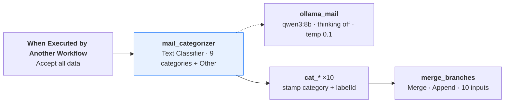

# mail_categorizer

Takes a batch of emails and decides what kind of mail each one is. Called as a sub-workflow by
`mail_label_draft`; it never runs on its own schedule. ⟦REVIEW src: workflow `mail_categorizer`, id
`aHXu3XwAQWA63AXJ`, read 2026-09-27⟧

It classifies and nothing else. It does not touch Gmail, apply labels, or write anything — it hands back the same
emails with two fields added. ⟦REVIEW⟧

## Why it is its own workflow

Classification is the one piece with a model in it, and the one piece that gets re-tuned. Keeping it apart means the
category set can change without opening the workflow that writes to Gmail. ⟦REVIEW⟧

It is also reusable. A future `mail_digest` or a backlog sweep can classify a batch without duplicating ten Set nodes.
⟦REVIEW⟧

## Flow



⟦REVIEW src: workflow `mail_categorizer`, 14 nodes⟧

## Input and output

**In:** whatever the caller sends. The trigger runs `Accept all data`, so no schema is declared and every field
survives the round trip. The classifier reads four of them: ⟦REVIEW src: `executeWorkflowTrigger`,
`inputSource: passthrough`⟧

```
From        the sender, display name and address
Subject     the subject line
body        trimmed plain text, URLs stripped
senderHint  what this sender usually gets, or empty
```

**Out:** the same items with two fields added. ⟦REVIEW⟧

```
category    one of the nine names below, or "other"
labelId     the matching Gmail label id, or "" for other
```

Nothing is removed. `Include Other Input Fields` is on in all ten Set nodes, which is what carries `id`, `threadId`
and the rest back to the caller. Turn it off in any one of them and the caller loses the data for that branch only —
a failure that shows up as one category silently breaking. ⟦REVIEW⟧

## The categories

| Category | Gmail label | Label ID |
|---|---|---|
| `security` | `security` | `Label_7` |
| `bills` | `bills` | `Label_6` |
| `job_interview` | `jobs/interview` | `Label_12` |
| `job_application` | `jobs/application` | `Label_3` |
| `job_rejected` | `jobs/rejected` | `Label_4` |
| `job_alert` | `jobs/alert` | `Label_5` |
| `newsletter` | `newsletter` | `Label_8` |
| `general` | `general` | `Label_9` |
| `orders` | `orders` | `Label_13` |
| *(no match)* | `other` — no label applied | `""` |

⟦REVIEW src: workflow `mail_categorizer`, the ten `cat_*` nodes⟧

**Category names use `job_alert`, not `jobs/alert`.** A slash is one more character for a small model to reproduce
wrongly. The Gmail name lives only in the Set node. ⟦REVIEW⟧

**The `jobs/` labels nest under one parent** so the whole family folds away when job hunting ends, and so a mix-up
between `jobs/alert` and `jobs/application` — the pair most often confused — still finds the email under `jobs`.
⟦REVIEW⟧

**`other` deliberately applies no label.** When the model cannot decide, the email keeps its category field but gets
no category chip. Uncertainty stays visible rather than being forced into `general`. ⟦REVIEW⟧

## The classifier

```
multiClass: false
fallback:   other
batchSize:  1
model:      qwen3:8b · thinking off · temperature 0.1
```

**Text Classifier, not an AI Agent.** It routes to one output per category, so an invalid label is structurally
impossible rather than prompt-discouraged. Parsing a label out of free text is the exact failure mode an 8B model is
worst at. ⟦REVIEW src: `@n8n/n8n-nodes-langchain.textClassifier`⟧

**`fallback: other`, not the default.** The default is `Discard Item`, which drops an undecided email silently — no
label, no log, gone. The Other branch makes uncertainty an output you can see. ⟦REVIEW src: node options, measured⟧

**`batchSize: 1`.** The default of 5 fires five concurrent requests at one local model on 16 GB. They queue anyway,
just worse. ⟦REVIEW src: CLAUDE.md, memory constraints⟧

### Input

```
From: {{ $json.From }}
Subject: {{ $json.Subject }}
{{ $json.body }}
{{ $json.senderHint }}
```

The fourth line is empty for unknown senders and costs nothing when absent. ⟦REVIEW⟧

### System prompt

Seven rules, each traceable to an observed misclassification: ⟦REVIEW src: workflow `mail_categorizer`,
systemPromptTemplate⟧

| Rule | What it fixed |
|---|---|
| prefer a `job_` category over general or newsletter | job mail scattered across three categories |
| only `job_rejected` on an explicit statement | polite "we'll keep you on file" read as a rejection |
| a dated ask means `job_interview` over `job_application` | interview invitations filed as status updates |
| when tied, pick the more visible category | quiet mail disappearing into `newsletter` |
| marketing is `newsletter`, even from a bank you use | HSBC and HDFC promos landing in `general` |
| a verification code is always `security` | a Vapi one-time code filed as `general` |
| prefer what past mail from this sender got | Glassdoor's personalised subjects reading as recruiter mail |

## The ten Set nodes

One per classifier output. Each writes two fixed strings and nothing else. ⟦REVIEW⟧

**Label IDs are hardcoded, one place each.** Gmail label IDs never change once created, so a runtime lookup would add
an API call and a merge to solve a problem that does not occur. Each ID appears in exactly one node, visible on the
canvas, with nothing to keep in sync. ⟦REVIEW⟧

## merge_branches

**Merge, Append mode, `Number of Inputs: 10`.** ⟦REVIEW⟧

**This node is load-bearing, not cosmetic.** Wiring ten branches straight into the caller makes n8n run the next node
**once per branch that has data** — visible as "Run 5 of 5" — so anything holding state across items resets on every
run. Merge waits for all ten and hands over one batch. ⟦REVIEW src: measured, 2026-09-26⟧

**`Number of Inputs` defaults to 2**, and inputs 3 and above then drop silently at runtime while the connection lines
still show on the canvas. ⟦REVIEW src: n8n Merge node default⟧

**Append, not Combine.** The branches hold different emails, not different fields of one email. Nothing to join.
⟦REVIEW⟧

**Merge caps at 10 inputs.** An eleventh category needs a second Merge node chained after the first. ⟦REVIEW src:
measured in the n8n UI, 2026-09-27⟧

## Accuracy

Roughly 16–17 of 20 on real mail, measured across three runs. ⟦REVIEW src: three 20-email runs, 2026-09-26⟧

Two rounds of description tuning moved it from ~14/20 and then stopped helping — a third round shuffled errors rather
than reducing them. Later fixes worked only where the mechanism was nameable: a brand name in a description
outweighing an abstract rule, or a category too broadly worded. ⟦REVIEW⟧

**The remaining errors are low-stakes by design.** Nothing here archives, deletes or replies. A wrong label leaves the
email in the inbox with the wrong colour on it. ⟦REVIEW⟧

## What this does not do

| Gap | Where it lands |
|---|---|
| No `travel` category | Merge is full at 10 inputs. Needs a second Merge node chained on ⟦REVIEW⟧ |
| No confidence score | The node routes, it does not report how sure it was ⟦REVIEW⟧ |
| Sender hint is supplied, not computed | The caller builds it; this workflow only reads it ⟦REVIEW src: `mail_label_draft`, build_sender_map⟧ |
