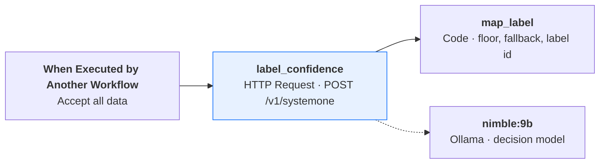

# mail_categorizer_jev

Takes a batch of emails and decides what kind of mail each one is, **and how sure it was**. Called as a sub-workflow by
`mail_label_draft`; it never runs on its own schedule.

It replaces [`mail_categorizer`](mail_categorizer.md), which did the same job with a Text Classifier and
`qwen3:8b`. Same inputs, same outputs, three nodes instead of fourteen.

## Why it replaced the Text Classifier version

The old one **wrote a category name**. This one **picks from a list and returns a probability for every option**.

That difference is the whole point. A written label at 95% certainty and a written label at 31% certainty look
identical on the canvas, so the previous accuracy plateau — 16–17 of 20, two tuning rounds that stopped helping —
was being measured blind. A confidence number makes a bad answer visible before it reaches Gmail.

Three further consequences fell out of it:

- **The ten Set nodes and the Merge disappear.** A Text Classifier routes to one output per category, so each branch
  needed a node to stamp `category` and `labelId`, and a Merge to collapse them. A decision model returns the answer as
  data in one item. The 10-input Merge cap that blocked a `travel` category goes with them.
- **`needs_reply` rides along in the same request.** One model call where there were two.
- **Adding a category is one line of JSON**, not a new branch, a new Set node and a Merge input.

## Flow



## Input and output

**In:** whatever the caller sends. The trigger runs `Accept all data`, so every field survives the round trip. Four are
read:

```
From        the sender, display name and address
Subject     the subject line
body        trimmed plain text, URLs stripped
senderHint  what this sender usually gets, or empty
```

**Out:** the same items with four fields added.

```
category    one of the nine names below, or "other"
labelId     the matching Gmail label id, or "" for other
confidence  0–1, how strongly one option won
needsReply  0–1, whether the sender wants something back
```

`category` and `labelId` are the contract `dedupe_and_flag` reads, unchanged from the old workflow — which is what made
the swap a single field change in `mail_label_draft`. `confidence` and `needsReply` are new and nothing consumes them
yet; they exist to be measured against.

## The categories

| Category | Gmail label | Label ID |
|---|---|---|
| `security` | `security` | `Label_7` |
| `bills` | `bills` | `Label_6` |
| `job_interview` | `jobs/interview` | `Label_12` |
| `job_application` | `jobs/application` | `Label_3` |
| `job_rejected` | `jobs/rejected` | `Label_4` |
| `job_alert` | `jobs/alert` | `Label_5` |
| `newsletter` | `newsletter` | `Label_8` |
| `general` | `general` | `Label_9` |
| `orders` | `orders` | `Label_13` |
| *(below the floor)* | `other` — no label applied | `""` |

Unchanged from the Text Classifier version, including the reasons: names use `job_alert` rather than `jobs/alert`
because a slash is one more character to reproduce wrongly, and `other` deliberately applies no label so uncertainty
stays visible instead of being forced into `general`.

`travel` (`Label_14`) exists in Gmail and is still unused — but now only because nothing has asked for it, not because
a Merge node is full.

## `label_confidence` — HTTP Request

```
POST http://host.docker.internal:11434/v1/systemone
Body Content Type:  JSON
Items per Batch:    1
Batch Interval:     0
Retry On Fail:      on · 3 tries · 2000 ms
On Error:           Continue (using error output)
```

**An HTTP Request node, not the Ollama node.** `/v1/systemone` shipped with Ollama 0.35 and no n8n node speaks it yet.
The URL is `host.docker.internal`, the same local Ollama every other workflow uses — nothing leaves the machine and
there is no credential.

**`Items per Batch: 1`.** The default fires several requests at once. Ollama serves one model at a time, so the rest
queue and burn the 5-minute HTTP timeout while waiting. Measured: five concurrent requests produced seven timeouts
across 25 emails, scattered rather than at the tail.

**Retry, matching the four Gmail nodes.** An alert then means three consecutive failures, not one busy moment.

**The Error output is deliberately left unconnected.** A failed email never reaches `dedupe_and_flag`, so `sorted` is
never applied, so `-label:sorted` picks it up again on the next run. Self-healing. Wiring the error branch into
`map_label` looks tidier and is worse: an error item has no `answers` key, falls straight through to the sender-history
fallback, and gets `sorted` applied on the strength of a request that never succeeded.

### The request

```json
{
  "model": "nimble:9b",
  "keep_alive": "30s",
  "state": {
    "from": "…", "subject": "…", "body": "…", "sender_history": "…"
  },
  "questions": {
    "category":    { "type": "choice", "instructions": "…", "criteria": { "…": "nine" } },
    "needs_reply": { "type": "noul",   "instructions": "…" }
  }
}
```

**The four state values are built with `JSON.stringify`, not pasted raw.** Email bodies carry quotes and newlines;
dropped in unescaped they break the JSON and the node fails with *"The value in the JSON Body field is not valid
JSON"*. `JSON.stringify` supplies the surrounding quotes too, which is why there are none in the template.

**`state` is an object, not one string.** `instructions` can then point at a field by name — ``using `from`, `subject`
and `body``` — which gives the model structure rather than a blob.

**Question keys are arbitrary.** `category` and `needs_reply` are our names; the answer comes back under the same keys.
`category` matches the downstream field so nothing needs translating.

### The response

```json
{
  "answers": {
    "category": {
      "type": "choice",
      "choice": "job_rejected",
      "probabilities": { "job_rejected": 0.987, "job_application": 0.013 },
      "confidence": 0.969
    },
    "needs_reply": { "type": "noul", "noul": 0.007 }
  },
  "usage": { "input_tokens": 1607, "output_tokens": 3 }
}
```

`output_tokens: 3` every time. The model is not writing anything — it is scoring the nine options you supplied.

## Why `nimble:9b`

| | `tev1:4b` | `nimble:9b` |
|---|---|---|
| Disk | 4.4 GB | 9.5 GB |
| Context | ~2,000 tokens | 8,192 tokens |
| Verdict | rejected | in use |

**`tev1` was tried first and rejected on context.** With the original nine descriptions a request measured 2,195
input tokens — past tev1's stated ~2,000 context and well past the ~1,500 it was trained on. Ollama truncates silently
from the start of the prompt, so it answered correctly on an easy case while giving no way to know whether it had read
everything.

**`keep_alive: "30s"`, not `0` and not `5m`.** The timer resets on every request, so a short value never unloads
mid-batch; it only shortens the idle tail. `0` unloads after each email and made all 25 requests pay a ~9 s reload,
which is what caused the first run's timeouts. `5m` leaves 8.9 GB resident long after work ends, which is felt on a
16 GB machine.

**It fits, with no headroom.** `ollama ps` reports `100% GPU`, and the server log shows `offloaded 33/33 layers to GPU`
— but also `reason=metal_partial_offload` and *"disabling mmap"*, meaning Ollama judged it tight and read the whole
9.5 GB into memory rather than mapping it. That is the ~9 s cold load. `qwen3:8b` cannot be resident at the same time,
which is what `keep_alive` is managing.

## The criteria

Nine descriptions, roughly 550 tokens in total.

**They were cut by two thirds from the Text Classifier versions, and both speed and accuracy improved.** The long
versions existed to steer a text generator — cross-references between categories, tie-break rules, "choose this only
when no other fits". A decision model scores all nine simultaneously, so the tie-break rules are redundant: the
probabilities *are* the tie-break. What remains is concrete nouns and brand names, which measurably carry weight.

Measured on the same six emails before and after the cut:

| | Long criteria | Short criteria |
|---|---|---|
| Input tokens | ~2,400 | ~1,600 |
| Wall clock, 6 emails | 1 m 42 s | 48 s |
| CodeRabbit trial expiry | `other` 0.554 | `bills` **0.968** |

Two clauses were added to target measured misses, and both landed:

- `bills` — *"trials ending that need payment to continue"* fixed the CodeRabbit trial notice
- `bills` — *"bank transaction alerts … UPI and card activity"* moved HDFC UPI alerts from `general` 0.749 to `bills`
  0.895, without dragging the HSBC UPI *cashback promo* out of `newsletter`

**`general` was the vaguest of the nine, which made it a magnet.** The original wording — *"a one-off transactional
notice about something the user did"* — describes a payment, an account change and a purchase equally well, so it
overlapped `bills`, `security` and `orders` by construction and kept turning up as a strong runner-up on emails that
belonged elsewhere. Rewritten to name what actually lands there: a real person writing, or a service notification
that is not money, not account access, not a job and not a purchase — someone messaged or commented, a profile was
created, a document was shared, a review was posted. Concrete examples in place of the abstract phrase, the same
lever that worked on `bills`.

## `map_label` — Code, Run Once for Each Item

Flattens `answers.category.choice` into `category`, applies the floor, maps to a label id, and glues the email fields
back on.

**`Run Once for Each Item`, not All Items.** `label_confidence` has an error output, so a failed email leaves the
success stream — and the reply at position 2 is then no longer the email at position 2. Position-based pairing
(`$('…').all()[i]`) silently shifts every answer after the first failure. In the first 25-email run this attached the
right answers to the wrong emails: the Slack confirmation code showed `general` while an Amazon advert showed
`security`. `.item` follows n8n's own paired-item link instead of counting, and Each Item mode is what makes `.item`
resolve.

**The rule generalises:** any Code node downstream of a node set to `Continue (using error output)` must use `.item`,
never `.all()[i]`. Five nodes in `mail_label_draft` are set that way.

```js
const FLOOR = 0.6;

const mail = $('When Executed by Another Workflow').item.json;
const { choice, confidence = 0 } = $json.answers?.category ?? {};

const hinted = mail.senderHint?.match(/were (\w+)\./)?.[1];
const category = confidence >= FLOOR ? choice : (hinted ?? 'other');
```

**The floor is 0.6.** Below it the model was guessing, so its pick is discarded.

**The sender-history fallback catches the discard.** `senderHint` is a sentence the caller built —
*"Past mail from this sender: 5 of 5 were general."* — and the regex lifts the category out of it. Safe because
`build_sender_map` only records a sender at **3+ labelled emails with 80% agreement**; it is measured history from the
inbox, not a guess. It runs only when the model already failed, so a confident answer is never overridden.

Measured: three emails where the model picked correctly but scored 0.41–0.60 while history said 4/4 or 5/5. Without the
fallback all three went to `other` and got no label.

**Label IDs are hardcoded in one object.** The old workflow hardcoded the same nine across ten separate Set nodes, so
this is a consolidation. A runtime `Label → Get Many` lookup would add an API call and a fan-in merge to guard against
IDs that only change when a label is deleted and recreated by hand.

## Accuracy

Measured on 25 real emails, the same pinned set across every run:

| | Old (`mail_categorizer`) | New |
|---|---|---|
| Labelled correctly | 16–17 of 20 | **22 of 25** |
| Held back, no label | 0 | 3 |
| **Confidently wrong** | 3–4 per 20 | **0** |

The last row is the one that matters. The old workflow applied a wrong label and gave no signal; this one declines.

The three held back were an unrecognised ChatGPT promo (0.543), a LinkedIn invitation from a real recruiter (0.585,
`needsReply` 0.80), and an HDFC "Account update" with an empty body whose probabilities split four ways (0.432). All
three are genuinely ambiguous, and the numbers say so.

**Errors remain low-stakes by design.** Nothing here archives, deletes or replies. A wrong label leaves the email in
the inbox with the wrong colour on it; a withheld label leaves it with no colour.

## What this does not do

| Gap | Where it lands |
|---|---|
| `needsReply` is computed but unused | `reply_check` in `mail_label_draft` still runs its own Text Classifier. Folding it in removes a model call |
| `needs_reply` over-fires on calls to action | CodeRabbit's "add the payment method" scored 0.873. Harmless today — `filter_repliable` only passes `general`, `job_application` and `job_interview` |
| No `travel` category | One line of criteria and one map entry away. Nothing blocks it any more |
| The floor is a fixed 0.6 | Not tuned per category. A `security` miss costs more than a `newsletter` miss |
| Sender hint is supplied, not computed | The caller builds it; this workflow only reads it |
| A failed email is silent | It retries on the next run, but nothing reports that it failed |
