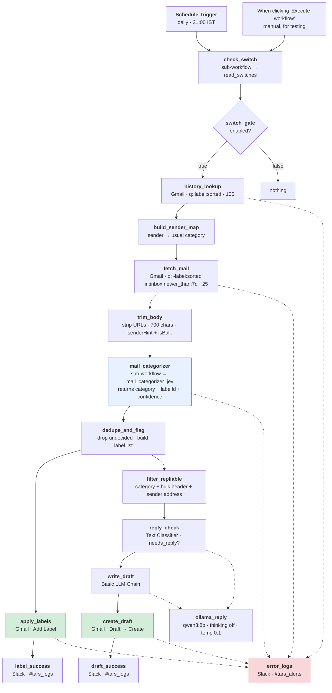

# mail_label_draft

Labels Gmail on a schedule, and writes a draft reply for the handful of emails a person is actually waiting on. The
mail domain's only scheduled workflow.

**It labels and drafts. It never archives, deletes, or sends.** A draft cannot leave by accident, and nothing is ever
hidden from the inbox.

## Why it exists

An inbox of 6,000-plus messages has no shape. Gmail's own tabs sort by sender behaviour, not by what the mail is *to
you* — a rejection and a job digest both land in Updates. The useful question is "what kind of thing is this, and does
someone want an answer", and both halves are answerable locally.

## Flow



Published, Schedule Trigger once a day at 21:00 IST. The manual trigger sits alongside it for testing and for deliberate
backlog sweeps. Both run through the switch gate, so there is no path that bypasses it.

### The switch gate

`check_switch` calls the `read_switches` helper with this workflow's name; `switch_gate` continues only when it
answers `enabled: true`. Untick `mail_label_draft` in `control_plane/switches.md` and the run ends there, green, in
146 ms — no Gmail call, no model, and the watchdog posts a grey *paused* card instead of an amber alert.

It **fails open**: a missing or unreadable vault lets the run continue. See [`control_plane.md`](control_plane.md)
for the three settings that produce that and why an unwanted run is the cheaper mistake here.

Two branches leave `dedupe_and_flag`. The labelling branch handles every email; the draft branch handles the one or
two that survive `filter_repliable`. They run independently.

## The labelling branch

### `history_lookup` — Gmail, Get Many

```
q:        label:sorted
limit:    100
Simplify: on
```

Fetches mail already labelled, as raw material for the sender map.

**It sits on the trigger, not on the mail.** A Gmail node runs once per input item; the trigger emits exactly one, so
this is one API call per run rather than one per email.

**Simplify on here, unlike `fetch_mail`.** Only the sender and the labels are needed, and Simplify returns both while
keeping the payload small.

**No leading minus.** The exact inverse of `fetch_mail` — this wants what has already been handled.

### `build_sender_map` — Code

Counts what each sender usually gets, and emits **one item** holding the map.

```js
if (!l.id.startsWith('Label_') || l.name === 'sorted') continue;
```

**`Label_` separates your labels from Gmail's.** Every message carries `INBOX`, `UNREAD` and often a `CATEGORY_*`;
none are informative. User labels are the only ones with `Label_` ids, so one check does the filtering — and a label
added later needs no edit here.

```js
if (total >= 3 && n / total >= 0.8) senderMap[from] = { top, n, total };
```

**The threshold guards against self-reinforcement.** The map is built from labels this workflow applied, so a mistake
could teach itself. Three emails and 80% agreement means one bad label among good ones cannot flip a sender.

**Correcting a label by hand is the training signal.** The map reads whatever is in Gmail, so a relabel propagates on
the next run.

**One item out** is what keeps `fetch_mail` to a single call downstream.

### `fetch_mail` — Gmail, Get Many

```
q:        -label:sorted in:inbox newer_than:7d
limit:    25
Simplify: off
```

Three clauses, three jobs. `-label:sorted` is the idempotency key — anything already handled is invisible, so Gmail
filters server-side and those messages are never fetched. `in:inbox` ignores mail already filed by hand.
`newer_than:7d` caps the blast radius so a run cannot touch years of history.

Gmail search excludes Spam and Trash by default.

**Limit 25, not 100.** At ~16–18s per email a batch of 100 runs ~26 minutes and overruns the schedule. 25 finishes in
about 7 minutes and still covers 1,200 emails a day.

**Simplify off is required.** See [Measured findings](#measured-findings).

### `trim_body` — Code

Turns a 126 KB raw Gmail message into the few hundred characters the model reads.

- **Strips URLs.** A bulk email's plain-text body is largely tracking links; without this, 700 characters of "body" is
  600 characters of `click4.example.com/CL0/…`.
- **Collapses whitespace, truncates to 700 characters.** Long enough to reach the decisive sentence, short enough to
  keep an 8B model accurate.
- **Drops `html` and `textAsHtml`.** The large payload dies here.
- **Attaches `senderHint`** by looking the sender up in the map. Unknown senders get an empty string.

Output field names are deliberately `Subject` and `From`, matching Simplify's spelling, so downstream expressions read
the same either way.

### `mail_categorizer` — Execute Sub-workflow

```
Mode:                            Run once with all items
Wait For Sub-Workflow Completion: on
```

Sends the batch out and gets it back with `category` and `labelId` added. Detail in
[`mail_categorizer_jev.md`](mail_categorizer_jev.md).

**The node is named `mail_categorizer`, and what it dials is `mail_categorizer_jev`.** Node name and target workflow
are separate things; the name stayed so the canvas and the wiring did not change. The old
[`mail_categorizer`](mail_categorizer.md) workflow is still published and is the rollback — set the Workflow field
back and nothing else moves, because both return the same two fields.

The new one also returns `confidence`. Nothing downstream reads it yet.

**`reply_check` stays where it is.** The sub-workflow could answer the same question in the same request, but it would
then run on all 25 emails instead of the 0–2 that survive `filter_repliable`. Two model calls are cheaper than
twenty-five extra prefills — detail in [`mail_categorizer_jev.md`](mail_categorizer_jev.md).

**Mode matters.** On `Run once for each item` the sub-workflow starts 25 separate times — 25 model startups instead of
one batched run.

**The node stores `mappingMode: defineBelow` with an empty value object, and this is not a bug.** The sub-workflow's
trigger runs `Accept all data`, so n8n skips input mapping entirely and every field passes through. Verified by
inspecting what `dedupe_and_flag` receives.

### `dedupe_and_flag` — Code

Builds `labelsToAdd` — `Label_11` (`sorted`) plus the category label — but only for emails the categorizer decided on.

**An undecided email gets no label at all.** No category, and no `sorted` either. It is dropped here, so
`-label:sorted` finds it again the next night and it ages out of the seven-day window on its own.

This replaced tagging every processed email with `sorted`. That version marked the undecided ones as handled and
excluded them from every later run, which meant the emails the model understood least were the only ones guaranteed
never to be looked at again. The marker has to be the outcome, not the fact that the workflow ran.

The node no longer deduplicates despite the name. One email could arrive twice only while the nine `cat_*` branches
merged into it; `mail_categorizer` is now its single input, so the `Set` of seen ids was dead code and was removed.

### `apply_labels` — Gmail, Add Label

```
Message ID:         {{ $json.id }}
Label Names or IDs: {{ $json.labelsToAdd }}
```

The multi-select label field accepts an expression returning an array, which lets one node cover all ten categories
instead of ten nodes.

Gmail's add-label call is idempotent — adding a label already present is a no-op, not an error.

## The draft branch

Four gates, cheapest first. Each one exists so the next is affordable.

### 1. `filter_repliable` — Code, no model

Three questions, all answerable from data already in hand.

**Is the category one that could ever need a reply?** Only `general`, `job_application` and `job_interview`. A bill or
a security alert already has a loud label; a second flag adds nothing.

**Did a machine send it?** `trim_body` sets `isBulk` from the `list-unsubscribe`, `list-id` and `feedback-id`
headers, which every platform and newsletter sets and a person never does. `feedback-id` is Google's Postmaster Tools
header, so it reads as *sent by bulk infrastructure* rather than *this is a mailing list* — looser, and the reason
Amazon's and Groww's transactional notices are caught despite carrying no unsubscribe link. One header check covers every sender at once — the alternative,
a list of platform domains, was rejected after a single night's inbox turned up 17 distinct domains.

**Is the sender a real mailbox?** The part before the `@` is checked against a list of words that mean nobody is
reading — `noreply`, `notifications`, `alerts`, `daemon` and about thirty more.

```js
const mailbox = (from.split('<').pop() ?? from).split('@')[0];
```

**Only the local part is searched, never the domain.** `careers@infosys.com` becomes `careers`. Matching the whole
string would find `info` and `sys` in the domain and silently drop a recruiter.

The header check and the word check overlap without containing one another — 20 of 25 and 19 of 25 on the same batch.
`noreply12.jobs2web.com` sets no bulk header and is caught by the words; a platform mailing from a human-looking
address is caught by the header. Both run.

This cuts 25 emails to 0, 1 or 2. That reduction is what makes the two model calls below cheap enough to justify.

### 2. `reply_check` — Text Classifier

Two categories — `needs_reply` and `no_reply_needed` — plus an unwired Other branch. Only `needs_reply` continues.

**Why a model and not more rules.** Whether an email wants an answer is a question about intent, and keyword matching
gets it wrong in both directions: *"Please do not reply to this email"* contains `please`, while *"Send over your
notice period"* contains no question mark. Of 2,061 workflows in the community collection, not one attempts this with
rules.

**Six rules in the system prompt**, the last of which sets the failure direction:

```
- When genuinely unsure, choose no_reply_needed.
```

A missing draft costs nothing — the email is still labelled and sitting in the inbox. An unwanted draft costs
attention.

### 3. `write_draft` — Basic LLM Chain

**A Chain, not an Agent.** One email in, one block of text out. An Agent can choose a tool, choose the wrong one, or
loop; a Chain has no tools to reach for. Same principle as using a Text Classifier for routing.

**The rule that matters:**

```
You do not know Swapnil's availability, notice period, salary, address,
schedule or opinions. Never state any of them. Write a named placeholder
in square brackets instead, like [YOUR AVAILABILITY].
```

Without it, `qwen3:8b` invents. Measured on a test email asking for availability and notice period, the model
confidently answered *"Monday, Wednesday, or Thursday"* and *"my current notice period is 15 days"* — both fabricated,
both stated as fact.

**Rules alone did not fix it. Two worked examples did.** The same finding as `memory_agent`: rules describe the
outcome, an example gives the shape. After adding them the same email produced `[YOUR AVAILABILITY]` and
`[YOUR NOTICE PERIOD]`, with no preamble, no subject line and no markdown.

The examples are **summarised rather than quoted in full**, and one is deliberately not about jobs, so the model
copies the shape without dragging job framing into ordinary mail.

### 4. `create_draft` — Gmail, Draft → Create

```
Subject:            =Re: {{ $('reply_check').item.json.Subject }}
Message:            {{ $json.text }}
options.threadId:   {{ $('reply_check').item.json.threadId }}
options.sendTo:     {{ $('reply_check').item.json.From }}
```

**`threadId` is the difference between a useful draft and a lost one.** Without it the draft sits alone in Drafts,
disconnected from the email. With it, the draft appears inside the conversation, where you would look for it.

**`$('reply_check')` rather than `$json`.** `write_draft` outputs only `{ text: ... }` — the subject, thread and
sender were left behind, so the expression reaches back to the last node that still had them.

**Draft → Create only.** There is no send operation anywhere in this workflow. Safe by construction rather than by
rule, the same reasoning as the `:ro` mount on `briefing/`.

## Logging

Three Slack cards, and one thing that deliberately produces none.

### `label_success` — green, `#tars_logs`

One card per run: how many were sorted, how many the model could not decide, the category breakdown, and how many had
sender history to lean on.

```
Mail sorted
Sorted 20    Undecided 2
Breakdown    6 newsletter · 5 job_alert · 4 bills · 3 general · 2 security
mail_label_draft · 7 had sender history · labels only, nothing archived
```

A **Limit** node set to 1 item sits between `apply_labels` and this card. `apply_labels` runs once per email, so
without it you would get twenty identical cards. The counting is done inline in the Slack expressions.

**Two nodes are counted, not one.** *Sorted* reads `$('dedupe_and_flag').all()`, which now holds only the emails that
got a label. *Undecided* is the difference between `$('mail_categorizer').all()` and that, and *Breakdown* and the
sender-history count read `mail_categorizer` too, because the undecided emails are dropped before `dedupe_and_flag`
and would otherwise be invisible. Counting both sides is what makes *Undecided* an instrument: a run where the
categorizer fails outright reads 25 rather than producing no card at all.

**The counts are attempts, not successes.** They come from upstream of `apply_labels`, so if three of twenty labels
fail the green card still says 20. The red cards are what tell you otherwise — read the two channels together.

**If nothing is labelled, no card appears.** `label_success` sits downstream of `apply_labels`, which receives no
items when every email is undecided. Silence is itself a signal.

### `draft_success` — green, `#tars_logs`

One card per draft, naming the recipient and subject. `create_draft` already emits one item per draft and there are
only ever nought to two, so this needs nothing in front of it.

### `error_logs` — red, `#tars_alerts`

Five nodes route their failures here: `history_lookup`, `fetch_mail`, `mail_categorizer`, `apply_labels` and
`create_draft`. All five are set to `Continue (using error output)`, so a failure sends the item down a second wire
instead of killing the run.

That changes two things for the better. A per-item failure stops being a whole-run failure — if `apply_labels` chokes
on email five of twenty, the other nineteen still get labelled. And the four Gmail nodes retry three times at
two-second intervals first, so a card means three consecutive failures rather than one dropped connection.

It also means those five nodes no longer fail the execution, so `error_handler` does not fire for them. That is a
handover, not a hole: the per-node card covers the five, `error_handler` covers everything else. See
[`error_handler.md`](error_handler.md).

**The Slack nodes retry, and none of them swallow their own failures.** `error_logs`, `label_success` and
`draft_success` were once set to `Continue (using error output)` with that second output wired to nothing. Two things
went wrong at once: the error was discarded, and because n8n treats a node with `onError` set as *handled*,
`error_handler` did not fire either. A failed Slack post was invisible twice over. All three now use the default
`Stop Workflow` with **Retry On Fail: 3 tries, 5000 ms**. A bad minute at Slack is absorbed by the retry; a real
outage fails the execution, which is exactly what makes `error_handler` report it. The original worry — that an alert
node could take the whole workflow down — is answered by the retry, not by throwing the error away.

**Never turn on `Always Output Data` alongside an error output.** That combination fires both branches on a single
failure — measured in `memory_read`, where it produced two contradictory Slack cards and a return value that was a
coin flip.

### Quiet runs stay quiet

When `fetch_mail` finds nothing, no items flow and no card posts. Built when the schedule ran every 30 minutes, where
48 "0 emails" messages a day would have stopped the channel being read. Less load-bearing on a daily schedule, but a
quiet night still says nothing rather than posting a zero.

## Safety

The risk here is not a wrong label. It is a **hidden** email.

A mislabelled email is still in the inbox, still visible, still findable. An archived one is not. So every guard sits
on the archive step, and this workflow does not have one.

Rules agreed before building, still in force:

1. **Labels and drafts only. No archiving at all.** Enable archiving per label once accuracy is known.
2. **Nothing under `jobs/*` is ever archived**, at any stage. A buried recruiter email costs far more than scrolling
   past job alerts.
3. **The archive set was cut** from `{jobs/rejected, jobs/alert, newsletter}` to `{newsletter}` only.
4. **A sender allowlist** of ATS domains — greenhouse, lever, workday, ashby, smartrecruiters, icims — will skip
   archiving regardless of category. Deterministic, so no model can talk it out of it.
5. **Never archive what Gmail already flagged** `IMPORTANT` or `STARRED`.
6. **Uncertainty is visible, never silent** — the Other branches on both classifiers.

**Everything is reversible.** `label:sorted` finds every message this workflow has touched; select all and remove
labels to undo it entirely. Drafts are deleted like any other draft. Nothing is destroyed.

**Drafts are never written for `jobs/*` beyond `job_application` and `job_interview`**, and never for a rejection — a
mediocre auto-reply to a recruiter costs a real opportunity.

## Measured findings

### Gmail's `snippet` truncates before the point

Simplify-on returns no body, only Gmail's ~200-character `snippet`. For an Amazon rejection the snippet ended:

```
Hi Swapnil, Thank you for your application for the position of
Software Development Engineer I, IESP Merchant Tech (ID: …).
After careful consideration a
```

One word before *"decided to progress with other candidates"*. The model never saw the rejection, and what it did see
reads exactly like `job_application`.

Systematic rather than unlucky: rejections open with "thank you for your application" and put the decision afterwards,
so **every** rejection looks like an application update from the first 200 characters. Fixed by Simplify off plus
`trim_body`.

### Simplify changes the shape of the fields

| | Simplify on | Simplify off |
|---|---|---|
| Labels | `labels: [{id, name}]` | `labelIds: ['INBOX', …]` |
| Subject | `Subject` | `subject` |
| Sender | `From` (string) | `from.text`, `from.value[0].address` |
| Body | none, only `snippet` | `text`, `html`, `textAsHtml` |

A future `IMPORTANT`/`STARRED` guard therefore reads `$json.labelIds.includes('IMPORTANT')` after `fetch_mail`, but
`$json.labels.some(l => l.id === 'IMPORTANT')` after `history_lookup`.

### An 8B model invents facts about you unless shown otherwise

Covered under `write_draft` above. The general lesson is the one already recorded for `memory_agent`: when rules fail
on a small model, an example is the next lever, not more rules.

### Header-based bulk detection is weaker than it looks

RFC 3834 defines `Auto-Submitted`, and bulk senders are meant to set `Precedence: bulk` or carry `List-Unsubscribe`.
In practice a measured Instahyre message carried **none** of them — only a `Feedback-ID` from Amazon SES and a
`noreply@` address.

`filter_repliable` therefore checks the sender address, which caught that message where the headers did not. The
header check remains available if address matching proves insufficient.

## Cost

| | |
|---|---|
| Per email, classification | ~16–18s, ~1,430 tokens |
| Per email, draft | ~20s, only for emails passing all four gates |
| Per run | 25 emails ≈ 7 minutes |
| Schedule | daily, 21:00 IST |
| Gmail quota | ~4,000 units/run against a 15,000/minute per-user limit |

`history_lookup` fetches 100 messages every run whether or not there is new mail — nothing in quota terms, 20–40
seconds of work on a quiet run. The fix, if it ever matters, is an `If` that skips the rest when `fetch_mail` returns
nothing.

**The backlog is not being swept.** `newer_than:7d` caps it at one week. A full sweep of 6,000-plus messages would be
~27 hours of continuous local inference — a deliberate, separate decision, worth deferring until the classifier is
trusted, since labelling everything now bakes in today's error rate.

## What this does not do yet

| Gap | Where it lands |
|---|---|
| No `needs_reply` label | Gmail already shows a Draft chip on any thread carrying one, so a label would duplicate the UI |
| No archiving | Deliberate. `newsletter` only, once the labels are trusted |
| Nothing in Obsidian | `mail_digest` → `dashboard/mail_tracker.md` |
| No chat access | `mail_agent`, its own trigger and system message |
| Sender map sampled at 100 | Recent history only. Correct for now — recency is what matters — but a sample, not the whole record |
| A failed draft never retries | The labelling branch applies `sorted` regardless, so the email is not refetched. Remove `sorted` by hand to reconsider it |
