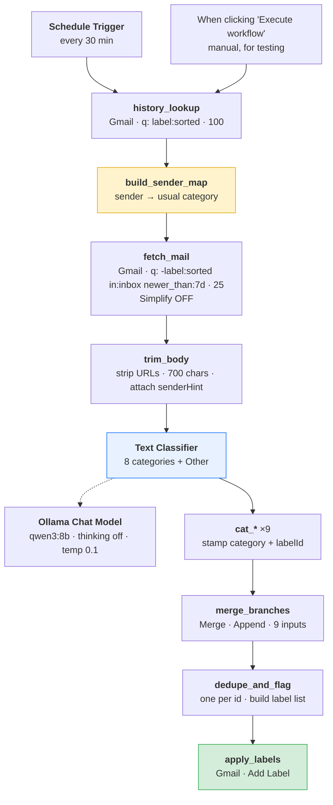

# mail_sort

Labels Gmail on a schedule, so the inbox says what kind of mail each thing is without anyone reading it first. The
first workflow in the **mail** domain, and the second domain in the project after memory. ⟦REVIEW src: workflow
`mail_sort`, read 2026-09-26⟧

**v1 only adds labels. Nothing is archived, deleted, moved or replied to.** That is a deliberate stopping point, not an
unfinished one — see [Safety](#safety-why-v1-only-labels). ⟦REVIEW⟧

## Why it exists

An inbox of 6,187 messages has no shape. Gmail's own tabs sort by sender behaviour, not by what the mail is *to you* —
a rejection and a job digest both land in Updates. The useful question is "what kind of thing is this", and that is a
classification problem a local model can answer. ⟦REVIEW src: Gmail account state, 2026-09-26⟧

## Flow



⟦REVIEW src: workflow `mail_sort`, 21 nodes, read 2026-09-26⟧

Published and running on a 30-minute Schedule Trigger. The manual trigger stays alongside it for testing and for
deliberate backlog sweeps. ⟦REVIEW src: workflow `mail_sort`, `active: true`, `minutesInterval: 30`⟧

## The label set

Two independent axes, as planned. Category is a single choice; flags are separate and orthogonal. ⟦REVIEW src: PLAN.md
Phase 4.1⟧

| Gmail label        | ID                        | Classifier category | Archived in v1 |
|--------------------|---------------------------|---------------------|----------------|
| `jobs`             | `Label_2`                 | — *(parent only)*   | no             |
| `jobs/application` | `Label_3`                 | `job_application`   | no             |
| `jobs/interview`   | `Label_12`                | `job_interview`     | no             |
| `jobs/rejected`    | `Label_4`                 | `job_rejected`      | no             |
| `jobs/alert`       | `Label_5`                 | `job_alert`         | no             |
| `bills`            | `Label_6`                 | `bills`             | no             |
| `security`         | `Label_7`                 | `security`          | no             |
| `newsletter`       | `Label_8`                 | `newsletter`        | no             |
| `general`          | `Label_9`                 | `general`           | no             |
| `needs_reply`      | `Label_10`                | — *(flag, unbuilt)* | no             |
| `sorted`           | `Label_11`                | — *(marker)*        | no             |

⟦REVIEW src: Gmail `Label → Get Many`, 2026-09-26⟧

**`jobs/interview` was added beyond the original plan.** Interview mail is frequent and time-sensitive, and it is the
one job state that changes what you do today. `jobs/accepted` was considered and rejected: offers are rare, and 8B
models over-fire on rare positive categories — an interview invitation and an offer read nearly identically.
⟦REVIEW src: decision 2026-09-26⟧

**Label IDs are hardcoded, one place each.** They never change once created, so a runtime lookup would add an API call
and a merge to solve a problem that does not occur. Each ID lives in exactly one `cat_*` node, visible on the canvas,
with nothing to keep in sync. ⟦REVIEW⟧

**Category names use `job_alert`, not `jobs/alert`.** A slash in a category name is one more thing for a small model to
echo back wrongly; `build_sender_map` reconciles the two spellings in one line. ⟦REVIEW src: workflow `mail_sort`,
build_sender_map⟧

## Nodes

### `history_lookup` — Gmail, Get Many

```
q:        label:sorted
limit:    100
Simplify: on
```

Fetches mail this workflow has already labelled, as raw material for the sender map. ⟦REVIEW⟧

**It sits on the trigger, not on the mail.** A Gmail node runs once per input item; the trigger emits exactly one, so
this is one API call per run rather than one per email. ⟦REVIEW⟧

**Simplify on here, unlike `fetch_mail`.** Only the sender and the labels are needed, and Simplify returns both while
keeping the payload small. ⟦REVIEW src: measured node output, 2026-09-26⟧

**No leading minus.** The exact inverse of `fetch_mail` — this wants what has already been handled. ⟦REVIEW⟧

### `build_sender_map` — Code, run once for all items

Counts what each sender usually gets, and emits one item holding the map. ⟦REVIEW⟧

```js
if (!l.id.startsWith('Label_') || l.name === 'sorted') continue;
```

**`Label_` separates your labels from Gmail's.** Every message carries `INBOX`, `UNREAD` and often a `CATEGORY_*`;
none of them are informative. User labels are the only ones with `Label_` IDs, so that one check does the filtering —
and a label added later needs no edit here. ⟦REVIEW⟧

```js
if (total >= 3 && n / total >= 0.8) senderMap[from] = { top, n, total };
```

**The threshold is the guard against self-reinforcement.** The map is built from labels this workflow applied, so a
mistake could teach itself. Requiring three emails and 80% agreement means a single bad label among good ones cannot
flip a sender. ⟦REVIEW src: threshold taken from n8n template 11518, sender-history rule⟧

**Correcting a label by hand is the training signal.** The map reads whatever is in Gmail, so a relabel propagates on
the next run. ⟦REVIEW⟧

**It returns exactly one item**, which is what keeps `fetch_mail` to a single call downstream. ⟦REVIEW⟧

### `fetch_mail` — Gmail, Get Many

```
q:        -label:sorted in:inbox newer_than:7d
limit:    25
Simplify: off
```

Three clauses, three jobs. `-label:sorted` is the idempotency key — anything already handled is invisible, so Gmail
does the filtering server-side and those messages are never fetched. `in:inbox` ignores mail already filed by hand.
`newer_than:7d` caps the blast radius so a first run cannot touch years of history. ⟦REVIEW⟧

Gmail search excludes Spam and Trash by default, so neither needs excluding. ⟦REVIEW src: Gmail search behaviour⟧

**Simplify off is required, and it was not the first choice.** See [Measured findings](#measured-findings). ⟦REVIEW⟧

### `trim_body` — Code, run once for all items

Turns a 126 KB raw Gmail message into the few hundred characters the classifier actually reads. ⟦REVIEW⟧

- **Strips URLs.** A bulk email's plain-text body is largely tracking links; without this, 700 characters of "body" is
  600 characters of `click4.example.com/CL0/…`. ⟦REVIEW src: measured Instahyre message, 2026-09-26⟧
- **Collapses whitespace, truncates to 700 characters.** Long enough to reach the decisive sentence, short enough to
  keep an 8B model accurate. ⟦REVIEW⟧
- **Drops `html` and `textAsHtml`.** This is where the large payload dies, before nine Set nodes copy it. ⟦REVIEW⟧
- **Attaches `senderHint`** by looking this email's sender up in the map. Unknown senders get an empty string.
  ⟦REVIEW⟧

Output field names are deliberately `Subject` and `From` — matching Simplify's spelling — so nothing downstream had to
change when Simplify was turned off. ⟦REVIEW⟧

### `Text Classifier`

```
multiClass: false
fallback:   other
batchSize:  1
```

**Not an AI Agent.** It routes to one output per category, so an invalid label is structurally impossible rather than
prompt-discouraged. Independent writeups agree that where small models fail is output-format reliability, not
classification itself — which is exactly the failure a router node removes. ⟦REVIEW src:
`@n8n/n8n-nodes-langchain.textClassifier`; distil labs local email-classification writeup, read 2026-09-26⟧

**`fallback: other`, not the default.** The default is `Discard Item`, which drops an unsure email silently — no label,
no log, gone. Unacceptable when a recruiter email could be the uncertain one. The Other branch makes uncertainty
visible: the email gets `sorted` and stays in the inbox with no category. ⟦REVIEW src: node options, measured⟧

**`batchSize: 1`.** The default of 5 runs five concurrent requests against one local model on 16 GB. One at a time is
faster overall. ⟦REVIEW src: CLAUDE.md, memory constraints⟧

Input is four lines — sender, subject, trimmed body, sender hint. The system prompt carries seven rules, each traceable
to an observed failure. ⟦REVIEW src: workflow `mail_sort`, Text Classifier⟧

### `cat_*` ×9 — Set

One per classifier output, each stamping two fixed strings: `category` and `labelId`. `cat_other` sets an empty
`labelId` on purpose, so undecided mail gets `sorted` and no category. ⟦REVIEW⟧

`Include Other Input Fields` is on in all nine, or the email data would be discarded. ⟦REVIEW⟧

### `merge_branches` — Merge, Append, 9 inputs

**Number of Inputs must be set to 9.** It defaults to 2, and inputs 3–9 then drop silently at runtime while the
connection lines still show on the canvas. ⟦REVIEW src: n8n Merge node default⟧

Why it is needed at all is in [Measured findings](#measured-findings). ⟦REVIEW⟧

### `dedupe_and_flag` — Code, run once for all items

Keeps one copy per message ID, then builds `labelsToAdd` — always `Label_11` (`sorted`), plus the category label when
there is one. ⟦REVIEW⟧

`sorted` goes on every email including the undecided ones. That is what stops the next run re-reading them. ⟦REVIEW⟧

### `apply_labels` — Gmail, Add Label

```
Message ID:         {{ $json.id }}
Label Names or IDs: {{ $json.labelsToAdd }}
```

The multi-select label field accepts an expression returning an array, which is what lets one node cover all nine
categories instead of nine nodes. ⟦REVIEW src: n8n-mcp `get_node` for `nodes-base.gmail`, `labelIds` property⟧

Gmail's add-label call is idempotent — adding a label that is already present is a no-op, not an error. ⟦REVIEW src:
Gmail API behaviour⟧

## Safety — why v1 only labels

The risk in this workflow is not a wrong label. It is a **hidden** email. ⟦REVIEW⟧

A mislabelled email is still in the inbox, still visible, still findable. An archived one is not. So every guard sits
on the archive step, and v1 simply does not have one. ⟦REVIEW⟧

Rules agreed before building, and still in force: ⟦REVIEW src: design decisions 2026-09-26⟧

1. **v1 labels only. No archiving at all.** Run it, read the results, and enable archiving per label once the accuracy
   is known.
2. **Nothing under `jobs/*` is ever archived**, even later. A buried recruiter email costs far more than scrolling past
   job alerts.
3. **The archive set was cut** from `{jobs/rejected, jobs/alert, newsletter}` to `{newsletter}` only.
4. **A sender allowlist** of ATS domains — greenhouse, lever, workday, ashby, smartrecruiters, icims — skips archiving
   regardless of category. Deterministic, so it cannot be talked out of it by a model.
5. **Never archive what Gmail already flagged** `IMPORTANT` or `STARRED`.
6. **Uncertainty is visible, never silent** — the Other branch, above.

**Everything is reversible.** `label:sorted` in Gmail search finds every message this workflow has ever touched; select
all and remove labels to undo it entirely. Nothing is deleted. ⟦REVIEW⟧

**The `jobs/` nesting is itself a guard.** `jobs/alert` and `jobs/application` are the pair the model most often
confuses, and both sit under one parent — so clicking `jobs` finds the email either way. ⟦REVIEW⟧

## Measured findings

Five things this workflow taught that are not in any documentation. ⟦REVIEW⟧

### Gmail's `snippet` truncates before the point

Simplify-on returns no body, only Gmail's ~200-character `snippet`. For an Amazon rejection the snippet ended:

```
Hi Swapnil, Thank you for your application for the position of
Software Development Engineer I, IESP Merchant Tech (ID: …).
After careful consideration a
```

One word before *"decided to progress with other candidates"*. The model never saw the rejection, and what it did see
reads exactly like `job_application`. ⟦REVIEW src: measured, 2026-09-26⟧

This is systematic rather than unlucky: rejections open with "thank you for your application" and put the decision
afterwards, so **every** rejection looks like an application update from the first 200 characters. Fixed by Simplify
off plus `trim_body`. ⟦REVIEW⟧

### Simplify changes the shape of `labels`

| | Simplify on | Simplify off |
|---|---|---|
| Labels | `labels: [{id, name}]` | `labelIds: ['INBOX', …]` |
| Subject | `Subject` | `subject` |
| Sender | `From` (string) | `from.text`, `from.value[0].address` |
| Body | none, only `snippet` | `text`, `html`, `textAsHtml` |

Any future `IMPORTANT`/`STARRED` guard therefore reads `$json.labelIds.includes('IMPORTANT')` after `fetch_mail`, but
`$json.labels.some(l => l.id === 'IMPORTANT')` after `history_lookup`. ⟦REVIEW src: measured both modes, 2026-09-26⟧

### A Code node with nine inputs runs nine times

Wiring all nine `cat_*` nodes straight into `dedupe_and_flag` made n8n execute it **once per branch with data** —
visible as "Run 5 of 5". Each run starts with a fresh `seen` set, so the deduplication could only ever compare within
one branch. ⟦REVIEW src: measured execution, 2026-09-26⟧

`merge_branches` fixes it: Append waits for all nine, hands over one pile, and the Code node runs once. Confirmed as
"Run 1 of 1" with 20 items. ⟦REVIEW⟧

Append, not Combine — the branches hold *different emails*, not different fields of the same email. Nothing to join.
⟦REVIEW⟧

### Category descriptions plateau, and brand names beat rules

Accuracy went from ~14/20 to ~16–17/20 over two rounds of description tuning, then stopped improving — a third round
moved errors around rather than reducing them. ⟦REVIEW src: three 20-email runs, 2026-09-26⟧

Two later fixes did work, and both had a visible mechanism rather than being blind rewrites: ⟦REVIEW⟧

- A LinkedIn *message* notification was classified `job_alert` because the `job_alert` description names **LinkedIn**
  by name. A named brand outweighed the abstract rule requiring actual job openings. Fixed by excluding social
  notifications explicitly.
- A Google Cloud project-deletion warning went to `general`. `security` was widened to cover data and access loss, with
  a carve-out so renewal reminders stay in `bills`.

The general lesson: tuning works when you can name the mechanism, and shuffles errors when you cannot. ⟦REVIEW⟧

### Prompt contamination is easy and invisible

Explanatory prose pasted into `systemPromptTemplate` had `{categories}` substituted into it, so the model read
`security, bills, … must stay — the node substitutes the real list into it`. Meaningless, and it left a category name
in the most recency-weighted position in the prompt. ⟦REVIEW src: measured, 2026-09-26⟧

## Cost

| | |
|---|---|
| Per email | ~16–18s, ~1,430 tokens |
| Per run | 25 emails ≈ 7 minutes |
| Schedule | every 30 minutes |
| Gmail quota | ~4,000 units/run against a 15,000/minute per-user limit ⟦REVIEW src: Gmail API quota reference, 2026⟧ |

`history_lookup` fetches 100 messages on every run whether or not there is new mail. Quota-wise that is nothing; it is
20–40 seconds of work on a quiet run. The fix, if it ever matters, is an `If` that skips the rest when `fetch_mail`
returns nothing. ⟦REVIEW⟧

**The backlog is not being swept.** `newer_than:7d` caps it at one week. A full sweep of 6,187 messages would be ~27
hours of continuous local inference and is a deliberate, separate decision — worth deferring until the classifier is
trusted, since labelling everything now bakes in today's error rate. ⟦REVIEW⟧

## What this does not do yet

| Gap | Where it lands |
|---|---|
| No Slack logging | Next. One card per run to `#tars_logs` — counts, breakdown, how many were undecided, how many got a sender hint ⟦REVIEW⟧ |
| `needs_reply` never set | Designed, unbuilt. Header-based, not AI: `List-Unsubscribe`, `List-Id`, `Precedence: bulk`, `Auto-Submitted` other than `no`, plus a noreply-style sender pattern. Requires a second `Message → Get` on the `general` / `job_application` / `job_interview` subset ⟦REVIEW src: RFC 3834; measured — four of the user's bulk senders contain no "noreply" string at all⟧ |
| No archiving | Deliberate. `newsletter` only, once the labels are trusted ⟦REVIEW⟧ |
| No drafts | Depends on `needs_reply`. `Draft → Create` only, never for `jobs/*` ⟦REVIEW src: PLAN.md Phase 4.1⟧ |
| Nothing in Obsidian | `mail_digest` → `dashboard/mail_tracker.md` ⟦REVIEW src: PLAN.md Phase 4.1⟧ |
| No chat access | `mail_agent`, its own trigger and system message ⟦REVIEW src: PLAN.md Phase 4.1⟧ |
| Sender map sampled at 100 | Recent history only. Correct for now — recency is what matters — but it is a sample, not the whole record ⟦REVIEW⟧ |
