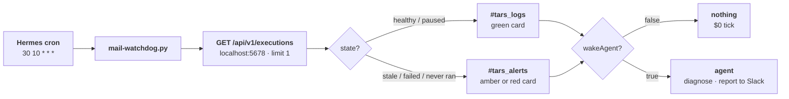

# mail_watchdog

A Hermes cron job that checks once a day whether `mail_label_draft` actually ran, and posts one Slack card saying so.
Green to `#tars_logs` when all is well, amber or red to `#tars_alerts` when it is not.

It is the only piece of this repository that runs **outside** n8n and Docker, and that is the entire point.

## Why it exists

On 2026-10-22 the Mac slept through the 21:00 schedule. `mail_label_draft` never ran. Nobody noticed until the
following morning.

`error_handler` could not have caught it. An Error Trigger needs an execution that started and failed — a run that
never started produces no execution, so no trigger fires and no card is posted. That is a blind spot by design, not a
bug, and nothing inside n8n can cover it:

| Failure | n8n-based check | This watchdog |
|---|---|---|
| Docker stopped | dead, silent | fires |
| n8n container crashed | dead, silent | fires |
| n8n running, workflow broken | fires | fires |
| Mac asleep | dead | dead |

The last row is honest: neither runs while the machine is asleep. That is why the rule is **staleness, not absence** —
the job wakes later, reads a timestamp, and sees the gap. A missed night is still visible the next morning.

Rows one and two are where it earns its place. A watchdog that dies with the thing it watches is not a watchdog.

Two further reasons it is not an n8n workflow:

- **It would share the bug class it checks for.** A node set to `Continue (using error output)` with nothing wired to
  the error branch reports **success** while dropping every item — three nights of mail went unlabelled that way. A
  Python script either runs or exits non-zero.
- **It reports its own death.** Script crashes → non-zero exit → Hermes delivers the failure itself. An n8n watchdog
  would depend on `error_handler`, which is the component that cannot see a missing run.

## Flow



## The wakeAgent gate

The job ran with `--no-agent` until 2026-10-31. That removed the LLM entirely, which was right about cost and wrong
about what happens next: a red card at 10:30 sat there until a person read it.

The job now runs in agent mode, but the script decides whether the agent runs at all. The last line of its stdout is
a JSON verdict Hermes reads:

```python
print(json.dumps({"wakeAgent": False}))                      # skip — $0
print(json.dumps({"wakeAgent": True, "context": {...}}))     # wake, with facts
```

| State | Wakes an agent |
|---|---|
| paused | no — deliberate, not a fault |
| healthy | no — nothing to diagnose |
| last run failed | yes |
| stale (>26h) | yes |
| never run | yes |

The gate is evaluated **before any model loads**, so a healthy morning still costs nothing: no tokens, no RAM, no
Ollama queue, no competing with `mail_label_draft` for the GPU. Only a bad morning spends anything.

Omitting the flag defaults to `true`, so a script that crashes before printing wakes the agent. That is the wanted
default — a watchdog that died is itself worth looking at.

**Why not `--monitor-script`.** Hermes' other gate compares this run's output against the last run's, byte for byte,
and wakes on any difference. The card contains `12.4h ago`, which changes every single day, so it would wake every
morning and mean nothing. It would also fire on *recovery*, treating "fixed itself" as news. `wakeAgent` lets the
script state its conclusion instead of having one inferred from its text.

**The decision stays deterministic.** The original objection to an LLM job — *"an 8B model can misread a timestamp
and report healthy when it is not"* — still holds, and the gate preserves it. Python decides whether something is
wrong; the model is only asked **why**, and only once Python has already said yes. A watchdog that lies is still
worse than no watchdog.

### What the agent is told

The prompt instructs it to diagnose and stop: read the execution, check whether the container is up, whether Ollama
answers `/api/tags`, and whether the Gmail credential has aged out. It ends with *"Change nothing. No restarts, no
re-runs, no config edits. This run diagnoses only."* Acting on its own is a later decision, to be made after reading
a few of its reports — not before.

The reply shape is fixed to four labelled lines:

```
*What broke* — one sentence
*Layer* — one of: n8n, Ollama, Gmail, schedule, unknown
*Evidence* — what you ran and what it returned
*Next action* — one thing, or "none"
```

Free prose was tried first and failed in the way this repository has now seen three times. The first real run
produced **two** `What Broke` lines contradicting each other, literal `\n` escape sequences instead of newlines, and
a wrong verdict. Two worked examples — one stale-but-not-failed, one genuine failure — fixed all three on the next
run. Same finding as `memory_agent`'s two-fact save and the draft branch's invented availability: a stated rule
slips, a shown shape holds.

The examples carry invented values — `example_workflow`, execution `10001`, `EXAMPLEERROR` — and say so in the
prompt. The first version used the real execution id and the real age, which made the test unfalsifiable: a report
quoting `execution 899` could have been checked or copied, and there was no way to tell. A copied `example_workflow`
is visible in Slack immediately; a copied `899` is not.

The prompt lives in `prompts/mail-watchdog.md` and is applied with:

```bash
hermes cron edit f8c760a9a8f4 --prompt "$(cat prompts/mail-watchdog.md)"
```

It is the only part of this job Hermes stores but git does not, so the file is the source and `jobs.json` is the
copy. Nothing enforces that — re-apply after editing.

Two by-design behaviours are named as **not** faults, because the first run reported one of them as the cause:

- `nimble:9b` and `qwen3:8b` are absent from `ollama ps` on purpose — `keep_alive: "30s"` evicts them between runs,
  since 16 GB cannot hold both resident. Only a model missing from `ollama list`, or `/api/tags` failing, is a fault.
- A stale workflow whose last run **succeeded** did not fail; it never started. No execution exists, so no error
  exists either — which is the blind spot this watchdog was built for, and the one thing a webhook can never catch.

It carries no `--model` pin, so it follows `model.default` (`qwen3.5:64k`, local). Vertex is configured in n8n but
not in Hermes — `VERTEX_CREDENTIALS_PATH` is empty — so moving this job to a hosted model is its own task.

## The files

Two files, both required in **both** locations:

| File | Role |
|---|---|
| `mail-watchdog.py` | the cron job. Decides state, picks channel, sends one card |
| `n8n_check.py` | shared helpers: `latest_execution()`, `hours_since()`, `send_card()`. Not a job — imported by the above |

```
~/.hermes/scripts/      what Hermes runs
scripts/                what git tracks
```

Hermes refuses any script resolving outside `$HERMES_HOME/scripts/`, and rejects symlink escapes, so a link pointing
into the repository does not work. Two copies are forced. **Edit the repo copy, then `cp` to `~/.hermes/scripts/`.**

Interpreter is chosen by file extension, and shebangs are deliberately ignored — `.sh`/`.bash` run under bash,
anything else under Hermes' own Python. That Python carries `requests` (Hermes depends on it), while the system
`python3` on this machine does not. Running a script directly from a shell therefore fails with
`ModuleNotFoundError` while the same file succeeds under `hermes cron run`.

## The rules

```python
MAX_AGE_HOURS = 26
```

| State | Condition | Colour | Channel |
|---|---|---|---|
| paused | the vault switch is `false` | grey | `#tars_logs` |
| healthy | `status == "success"` and age ≤ 26h | green | `#tars_logs` |
| stale | `status == "success"` and age > 26h | amber | `#tars_alerts` |
| failed | `status != "success"` | red | `#tars_alerts` |
| never ran | the executions list is empty | red | `#tars_alerts` |

Order matters. Paused is answered first and a failed run is reported as failed even when it is also old.

**Paused is checked before n8n is contacted at all.** `switch_enabled()` reads
`control_plane/switches.md` natively — Hermes is not in the container, so it opens the file at its real path rather
than `/vault/...` — and the script exits straight after sending the card:

```python
if not switch_enabled(NAME):
    send_card(LOGS, GREY, f":zzz: *{NAME}* — paused", ...)
    raise SystemExit
```

Pausing the mail and shutting Docker down for a trip is one action in practice, and the pair should give a quiet grey
card rather than a connection-refused failure every morning. `raise SystemExit` exits `0`, so Hermes does not file it
as a failed job.

Without this the watchdog could not tell a deliberate pause from a dead workflow — it reads `startedAt` and nothing
else, so an unticked box earned an amber *stale* card every morning. Full design in
[`control_plane.md`](control_plane.md).

**Why 26 and not 24.** The schedule is 21:00 daily, the check is 10:30. n8n fires missed schedules on wake, so a run
delayed by a sleeping Mac can land hours late — on 2026-10-23 the 21:00 run actually started at 22:18 IST. A 24-hour
window would alert on that. 26 tolerates a late catch-up and still catches a genuinely missed night.

**Why 10:30 and not 07:00.** The laptop stays shut until work starts around 10:00, and a closed lid sleeps regardless
of any `pmset` idle setting — so a 07:00 job never fired on time, it fired as a catch-up whenever the lid opened. The
schedule now matches when the machine is actually awake. **Temporary**: the real fix is moving this job to a host that
does not sleep, at which point it goes back to running before the working day rather than during it.

The threshold still holds at either time. A normal night leaves the last run 13.5 hours old at 10:30, against 10.5 at
07:00; a missed night leaves it 37.5 hours old. Both sit well clear of 26 on the correct side, so the move changes
when the card arrives, not what it says.

**Exactly one card per day, and that is deliberate.** An earlier version used two cron jobs — one that alerted and one
that always reported — which meant a bad state produced two cards carrying the same facts in two channels. Merging
them removed the duplicate without losing anything:

| Each morning | Means |
|---|---|
| grey in `#tars_logs` | switched off on purpose |
| green in `#tars_logs` | ran, fine |
| amber or red in `#tars_alerts` | ran, found a problem |
| nothing in either | the watchdog itself did not run |

That third row is why the healthy case posts at all. Silence alone cannot distinguish "nothing is wrong" from "the
check stopped happening".

## Credentials

n8n's API key reaches the script through `terminal.env_passthrough` in `~/.hermes/config.yaml`:

```yaml
terminal:
    env_passthrough:
        - N8N_API_KEY
        - WATCHDOG_WEBHOOK_ALERTS
        - WATCHDOG_WEBHOOK_LOGS
```

Names only — values live in `~/.hermes/.env`.

**Hermes' own platform credentials cannot be passed this way, and that shaped the design.** `cron.md` states the
subprocess environment is sanitized by `_sanitize_subprocess_env` so *"provider API credentials and other
Hermes-managed secrets are not inherited by cron scripts"*, and that *"Hermes-managed provider credentials
(`OPENAI_API_KEY`, gateway tokens, …) cannot be declared — the sanitizer rejects them"*. `security.md` repeats it:
`env_passthrough` registration remains **sealed**.

Measured rather than assumed. `SLACK_BOT_TOKEN` was added to `env_passthrough`, the gateway restarted, and a probe
job run:

```
N8N_API_KEY:             ***
SLACK_BOT_TOKEN:         MISSING
WATCHDOG_WEBHOOK_ALERTS: set
```

Declaring it also logs a refusal on every gateway start, citing `_HERMES_PROVIDER_ENV_BLOCKLIST` and
`GHSA-rhgp-j443-p4rf`.

So the script cannot post as the Hermes bot. It uses **Incoming Webhook URLs** instead, which are not Hermes-managed
credentials and pass through normally. One webhook per channel — a webhook's destination is fixed at creation and
cannot be overridden per message, which is why there are two.

## The card

Slack Block Kit has no colour of its own. The strip comes from wrapping the blocks in an **attachment**:

```json
{
  "attachments": [{
    "color": "#ecb22e",
    "blocks": [
      { "type": "section", "text": { "type": "mrkdwn", "text": ":warning: *mail_label_draft* — stale" } },
      { "type": "section", "fields": [ { "type": "mrkdwn", "text": "*Status*\n`success`" },
                                       { "type": "mrkdwn", "text": "*Last run*\n31.2h ago" } ] },
      { "type": "context", "elements": [ { "type": "mrkdwn", "text": "execution `868` · <…|open>" } ] }
    ]
  }]
}
```

Same shape as the cards `error_handler` and `mail_label_draft` post, so the three read alike in Slack.

Three details worth keeping:

- **No top-level `text`.** Slack renders it as a plain line above the card, which only repeats the title. Slack's
  documented error list includes `no_text`, but a payload carrying `attachments` and no `text` was tested against the
  live webhook and accepted.
- **Slack mrkdwn bold is `*one asterisk*`,** not two. Markdown's `**bold**` renders as italic here. Hermes' own
  delivery path converts Markdown first, so the two routes disagree — posting direct to a webhook needs the single
  form.
- **`fields` renders as two side-by-side columns,** which is what produces the Status / Last run layout.

Success is Slack answering HTTP 200 with the literal body `ok`. `send_card()` checks for exactly that and raises
otherwise, so a rejected card fails the job rather than vanishing.

## Delivery

The script owns the daily card: it posts straight to the two Slack webhooks, so the colour, the channel and the
layout are its own.

Hermes' own delivery (`--deliver slack`) carries the **agent's diagnosis**, on the rare mornings one runs. The two do
not overlap — one is the reading, the other is the explanation.

Hermes still files the script's stdout under `~/.hermes/cron/output/<job_id>/`, one file per run, which is the debug
trail when a card does not appear.

## No error handling, on purpose

There is one `try`/`except` in either file, in `switch_enabled()`, and it is the fail-open rule rather than error
handling — an unreadable switch file means the workflow is not paused, which is the same answer the n8n side reaches
through two On Error settings. Everywhere else the rule holds: if n8n is unreachable the `requests` call raises, the
script exits non-zero, and Hermes delivers that failure itself.

### That last sentence was false for five days

`--deliver local` does not only mean "the script owns the daily card". Hermes documents it as suppressing **failure
notices entirely**, and the execution record agrees — every run of this job recorded `delivery_outcome = suppressed`.
So a crashed watchdog reported to nobody. The watchdog built to catch silent failures had one.

Two real crashes went unheard:

```
2026-10-25  ConnectionRefusedError: [Errno 61] Connection refused     (Docker not up yet)
2026-10-27  socket.gaierror: nodename nor servname provided           (no DNS)
```

Fixed by `--failure-deliver slack`, which overrides the failure path alone and leaves the daily card where it was.
Worth generalising: a delivery setting chosen for the happy path silently decided the unhappy one too.

Seen in practice on 2026-10-25: the Mac was off at 07:00, Hermes fired the job as a catch-up at 11:14 on wake, Docker
had not started yet, and the job reported:

```
ConnectionRefusedError: [Errno 61] Connection refused
Last run: 2026-10-25T11:14:47  error: Script exited with code 1
```

`hermes cron list` prints the failing job's stderr inline, so one failure fills the screen with a chained Python
traceback. Read it bottom-up; the four frames are one cause.

## Verifying it

```bash
# what is scheduled, when it last ran, and any recorded failure
hermes cron list

# fire it once now
hermes cron run f8c760a9a8f4

# what the script printed
ls ~/.hermes/cron/output/f8c760a9a8f4/
```

To exercise the alert path without waiting for a real failure, lower `MAX_AGE_HOURS` in
`~/.hermes/scripts/mail-watchdog.py`, run the job, then put it back. With `MAX_AGE_HOURS = 1` a healthy workflow
reports stale and an amber card lands in `#tars_alerts`.

## First real catch

2026-10-25. `mail_label_draft` last ran 2026-10-23 at 22:18 IST; the 24th was missed entirely while the machine
travelled. The watchdog reported `alert sent: stale 37.0h` — the exact failure it was built for, on its first day in
service.

## What this does not do

| Gap | Note |
|---|---|
| No funnel check | It reads `status` and `startedAt` only. A run that reports `success` while labelling nothing still passes. The fix needs `?includeData=true` and a count of `fetch_mail` against `apply_labels`, alerting only on the binary `fetched > 0 and labelled == 0` — the labelled count swings 14–24 of 25, so no ratio threshold works |
| One workflow | `mail_label_draft` only. The memory workflows are unwatched. Generalising means a list of `(id, name, max_age)` and a loop, which is roughly ten lines — worth doing when a second workflow needs it, not before |
| Dead while the Mac sleeps | It detects a missed run; it cannot prevent one. Hermes' `multi-profile-gateways` guide has a section on keeping the host awake, which is the other half of the problem |
| No deduplication | A workflow stale for three days produces three identical amber cards |
| Ticking back on can raise one false alarm | The watchdog reads `startedAt` only. Pause for three days, tick back on after 21:00, and the next morning is amber *stale* — correct, but you already know why. Clears itself the day after. Tick back on before 21:00 to avoid it |
| Fixed thresholds | `MAX_AGE_HOURS` is a constant in the script, not configuration |
