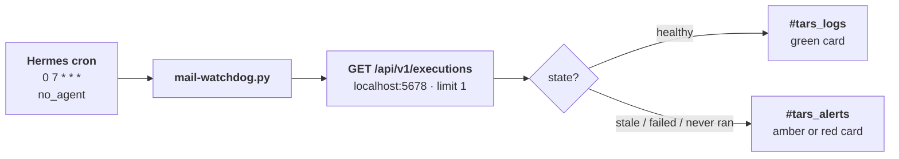

# mail_watchdog

A Hermes cron job that checks once a day whether `mail_label_draft` actually ran, and posts one Slack card saying so.
Green to `#tars_logs` when all is well, amber or red to `#tars_alerts` when it is not.

It is the only piece of this repository that runs **outside** n8n and Docker, and that is the entire point.

## Why it exists

On 2026-10-22 the Mac slept through the 21:00 schedule. `mail_label_draft` never ran. Nobody noticed until the
following morning.

`error_handler` could not have caught it. An Error Trigger needs an execution that started and failed — a run that
never started produces no execution, so no trigger fires and no card is posted. That is a blind spot by design, not a
bug, and nothing inside n8n can cover it:

| Failure | n8n-based check | This watchdog |
|---|---|---|
| Docker stopped | dead, silent | fires |
| n8n container crashed | dead, silent | fires |
| n8n running, workflow broken | fires | fires |
| Mac asleep | dead | dead |

The last row is honest: neither runs while the machine is asleep. That is why the rule is **staleness, not absence** —
the job wakes later, reads a timestamp, and sees the gap. A missed night is still visible the next morning.

Rows one and two are where it earns its place. A watchdog that dies with the thing it watches is not a watchdog.

Two further reasons it is not an n8n workflow:

- **It would share the bug class it checks for.** A node set to `Continue (using error output)` with nothing wired to
  the error branch reports **success** while dropping every item — three nights of mail went unlabelled that way. A
  Python script either runs or exits non-zero.
- **It reports its own death.** Script crashes → non-zero exit → Hermes delivers the failure itself. An n8n watchdog
  would depend on `error_handler`, which is the component that cannot see a missing run.

## Flow



## No-agent mode

The job runs with `--no-agent`, which removes the LLM from the cron path entirely. Hermes becomes a timer plus a
messenger:

```
scheduler tick ──▶ run script ──stdout──▶ delivery router
```

No model call, no tokens, no RAM, no Ollama queue. The watchdog never competes with `mail_label_draft` for the GPU.

The alternative — an LLM job given a prompt such as *"tell me if the mail workflow did not run"* — was rejected. It
costs a model call every morning and an 8B model can misread a timestamp and report healthy when it is not. A
watchdog that lies is worse than no watchdog.

## The files

Two files, both required in **both** locations:

| File | Role |
|---|---|
| `mail-watchdog.py` | the cron job. Decides state, picks channel, sends one card |
| `n8n_check.py` | shared helpers: `latest_execution()`, `hours_since()`, `send_card()`. Not a job — imported by the above |

```
~/.hermes/scripts/      what Hermes runs
scripts/                what git tracks
```

Hermes refuses any script resolving outside `$HERMES_HOME/scripts/`, and rejects symlink escapes, so a link pointing
into the repository does not work. Two copies are forced. **Edit the repo copy, then `cp` to `~/.hermes/scripts/`.**

Interpreter is chosen by file extension, and shebangs are deliberately ignored — `.sh`/`.bash` run under bash,
anything else under Hermes' own Python. That Python carries `requests` (Hermes depends on it), while the system
`python3` on this machine does not. Running a script directly from a shell therefore fails with
`ModuleNotFoundError` while the same file succeeds under `hermes cron run`.

## The rules

```python
MAX_AGE_HOURS = 26
```

| State | Condition | Colour | Channel |
|---|---|---|---|
| paused | the vault switch is `false` | grey | `#tars_logs` |
| healthy | `status == "success"` and age ≤ 26h | green | `#tars_logs` |
| stale | `status == "success"` and age > 26h | amber | `#tars_alerts` |
| failed | `status != "success"` | red | `#tars_alerts` |
| never ran | the executions list is empty | red | `#tars_alerts` |

Order matters. Paused is answered first and a failed run is reported as failed even when it is also old.

**Paused is checked before n8n is contacted at all.** `switch_enabled()` reads
`control_plane/switches.md` natively — Hermes is not in the container, so it opens the file at its real path rather
than `/vault/...` — and the script exits straight after sending the card:

```python
if not switch_enabled(NAME):
    send_card(LOGS, GREY, f":zzz: *{NAME}* — paused", ...)
    raise SystemExit
```

Pausing the mail and shutting Docker down for a trip is one action in practice, and the pair should give a quiet grey
card rather than a connection-refused failure every morning. `raise SystemExit` exits `0`, so Hermes does not file it
as a failed job.

Without this the watchdog could not tell a deliberate pause from a dead workflow — it reads `startedAt` and nothing
else, so an unticked box earned an amber *stale* card every morning. Full design in
[`control_plane.md`](control_plane.md).

**Why 26 and not 24.** The schedule is 21:00 daily, the check is 07:00. n8n fires missed schedules on wake, so a run
delayed by a sleeping Mac can land hours late — on 2026-10-23 the 21:00 run actually started at 22:18 IST. A 24-hour
window would alert on that. 26 tolerates a late catch-up and still catches a genuinely missed night.

**Exactly one card per day, and that is deliberate.** An earlier version used two cron jobs — one that alerted and one
that always reported — which meant a bad state produced two cards carrying the same facts in two channels. Merging
them removed the duplicate without losing anything:

| Each morning | Means |
|---|---|
| grey in `#tars_logs` | switched off on purpose |
| green in `#tars_logs` | ran, fine |
| amber or red in `#tars_alerts` | ran, found a problem |
| nothing in either | the watchdog itself did not run |

That third row is why the healthy case posts at all. Silence alone cannot distinguish "nothing is wrong" from "the
check stopped happening".

## Credentials

n8n's API key reaches the script through `terminal.env_passthrough` in `~/.hermes/config.yaml`:

```yaml
terminal:
    env_passthrough:
        - N8N_API_KEY
        - WATCHDOG_WEBHOOK_ALERTS
        - WATCHDOG_WEBHOOK_LOGS
```

Names only — values live in `~/.hermes/.env`.

**Hermes' own platform credentials cannot be passed this way, and that shaped the design.** `cron.md` states the
subprocess environment is sanitized by `_sanitize_subprocess_env` so *"provider API credentials and other
Hermes-managed secrets are not inherited by cron scripts"*, and that *"Hermes-managed provider credentials
(`OPENAI_API_KEY`, gateway tokens, …) cannot be declared — the sanitizer rejects them"*. `security.md` repeats it:
`env_passthrough` registration remains **sealed**.

Measured rather than assumed. `SLACK_BOT_TOKEN` was added to `env_passthrough`, the gateway restarted, and a probe
job run:

```
N8N_API_KEY:             ***
SLACK_BOT_TOKEN:         MISSING
WATCHDOG_WEBHOOK_ALERTS: set
```

Declaring it also logs a refusal on every gateway start, citing `_HERMES_PROVIDER_ENV_BLOCKLIST` and
`GHSA-rhgp-j443-p4rf`.

So the script cannot post as the Hermes bot. It uses **Incoming Webhook URLs** instead, which are not Hermes-managed
credentials and pass through normally. One webhook per channel — a webhook's destination is fixed at creation and
cannot be overridden per message, which is why there are two.

## The card

Slack Block Kit has no colour of its own. The strip comes from wrapping the blocks in an **attachment**:

```json
{
  "attachments": [{
    "color": "#ecb22e",
    "blocks": [
      { "type": "section", "text": { "type": "mrkdwn", "text": ":warning: *mail_label_draft* — stale" } },
      { "type": "section", "fields": [ { "type": "mrkdwn", "text": "*Status*\n`success`" },
                                       { "type": "mrkdwn", "text": "*Last run*\n31.2h ago" } ] },
      { "type": "context", "elements": [ { "type": "mrkdwn", "text": "execution `868` · <…|open>" } ] }
    ]
  }]
}
```

Same shape as the cards `error_handler` and `mail_label_draft` post, so the three read alike in Slack.

Three details worth keeping:

- **No top-level `text`.** Slack renders it as a plain line above the card, which only repeats the title. Slack's
  documented error list includes `no_text`, but a payload carrying `attachments` and no `text` was tested against the
  live webhook and accepted.
- **Slack mrkdwn bold is `*one asterisk*`,** not two. Markdown's `**bold**` renders as italic here. Hermes' own
  delivery path converts Markdown first, so the two routes disagree — posting direct to a webhook needs the single
  form.
- **`fields` renders as two side-by-side columns,** which is what produces the Status / Last run layout.

Success is Slack answering HTTP 200 with the literal body `ok`. `send_card()` checks for exactly that and raises
otherwise, so a rejected card fails the job rather than vanishing.

## Delivery

The cron job runs with `--deliver local`. The script owns delivery, so Hermes posts nothing — which also removes the
`Cronjob Response:` header and the "To stop or manage this job" footer Hermes prepends to its own deliveries.

Hermes still files the script's stdout under `~/.hermes/cron/output/<job_id>/`, one file per run, which is the debug
trail when a card does not appear.

## No error handling, on purpose

There is one `try`/`except` in either file, in `switch_enabled()`, and it is the fail-open rule rather than error
handling — an unreadable switch file means the workflow is not paused, which is the same answer the n8n side reaches
through two On Error settings. Everywhere else the rule holds: if n8n is unreachable the `requests` call raises, the
script exits non-zero, and Hermes delivers that failure itself.

Seen in practice on 2026-10-25: the Mac was off at 07:00, Hermes fired the job as a catch-up at 11:14 on wake, Docker
had not started yet, and the job reported:

```
ConnectionRefusedError: [Errno 61] Connection refused
Last run: 2026-10-25T11:14:47  error: Script exited with code 1
```

`hermes cron list` prints the failing job's stderr inline, so one failure fills the screen with a chained Python
traceback. Read it bottom-up; the four frames are one cause.

## Verifying it

```bash
# what is scheduled, when it last ran, and any recorded failure
hermes cron list

# fire it once now
hermes cron run f8c760a9a8f4

# what the script printed
ls ~/.hermes/cron/output/f8c760a9a8f4/
```

To exercise the alert path without waiting for a real failure, lower `MAX_AGE_HOURS` in
`~/.hermes/scripts/mail-watchdog.py`, run the job, then put it back. With `MAX_AGE_HOURS = 1` a healthy workflow
reports stale and an amber card lands in `#tars_alerts`.

## First real catch

2026-10-25. `mail_label_draft` last ran 2026-10-23 at 22:18 IST; the 24th was missed entirely while the machine
travelled. The watchdog reported `alert sent: stale 37.0h` — the exact failure it was built for, on its first day in
service.

## What this does not do

| Gap | Note |
|---|---|
| No funnel check | It reads `status` and `startedAt` only. A run that reports `success` while labelling nothing still passes. The fix needs `?includeData=true` and a count of `fetch_mail` against `apply_labels`, alerting only on the binary `fetched > 0 and labelled == 0` — the labelled count swings 14–24 of 25, so no ratio threshold works |
| One workflow | `mail_label_draft` only. The memory workflows are unwatched. Generalising means a list of `(id, name, max_age)` and a loop, which is roughly ten lines — worth doing when a second workflow needs it, not before |
| Dead while the Mac sleeps | It detects a missed run; it cannot prevent one. Hermes' `multi-profile-gateways` guide has a section on keeping the host awake, which is the other half of the problem |
| No deduplication | A workflow stale for three days produces three identical amber cards |
| Ticking back on can raise one false alarm | The watchdog reads `startedAt` only. Pause for three days, tick back on after 21:00, and the next morning is amber *stale* — correct, but you already know why. Clears itself the day after. Tick back on before 21:00 to avoid it |
| Fixed thresholds | `MAX_AGE_HOURS` is a constant in the script, not configuration |
