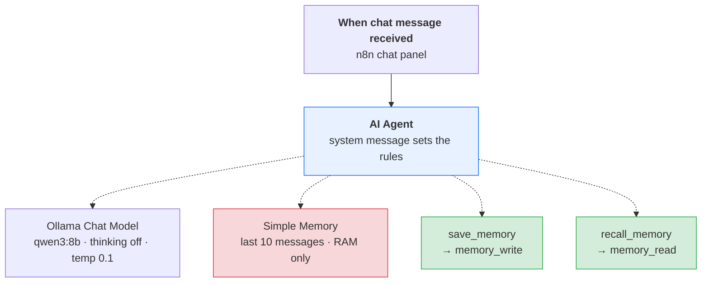

# tars_agent

The production assistant. Everything else in this repository exists to serve it. ⟦REVIEW⟧

`test_chat_LLM` remains a learning scaffold and is not part of this. ⟦REVIEW src: docs/test_workflows.md⟧

## Shape



⟦REVIEW src: workflow `tars_agent`, read 2026-09-24⟧

Dotted lines are sub-node connections — the model, memory and tools hang under the agent rather than passing data along a chain. ⟦REVIEW⟧

## Two kinds of memory

Not alternatives. Each does a job the other cannot. ⟦REVIEW⟧

| | Simple Memory | the memory files |
|---|---|---|
| Holds | the last 10 messages | facts chosen deliberately |
| Lives in | RAM | the Obsidian vault |
| Survives a restart | no | yes |
| Should it? | **no** | **yes** |
| Written by | automatically | `save_memory` |
| Read by | automatically | `recall_memory` |

Simple Memory forgetting is correct behaviour. Last week's chatter in today's context is expensive noise on a 16,384-token budget, and the entire prior conversation is re-sent with every message. ⟦REVIEW src: docs/test_workflows.md, agent run section⟧

The filtering step is the tool call: whatever is worth keeping gets written to a file. ⟦REVIEW⟧

**Context Window Length is 10** — enough to follow a conversation, small enough to leave room for the memory files `recall_memory` returns. ⟦REVIEW src: workflow `tars_agent`, Simple Memory node⟧

The two interact usefully. Once `recall_memory` has run in a conversation, the files are in Simple Memory, so a follow-up question needs no second call. ⟦REVIEW src: execution log 2026-09-24 — a memory update reused a filename read three messages earlier without re-calling recall_memory⟧

Persistent chat memory exists in n8n as Postgres and Redis sub-nodes. Neither is running; swapping the node is a five-minute change and arrives with Phase 5. ⟦REVIEW src: PLAN.md Phase 5⟧

## Model settings

```
model:        qwen3:8b
think:        false
temperature:  0.1
```

⟦REVIEW src: workflow `tars_agent`, Ollama Chat Model node⟧

Both non-default values come from measurement. Thinking mode took 4m 39s on one query; disabled, with proper tools and a system prompt, the same query took 20s and was correct. Tool calls are structured JSON, and a default chat temperature encourages the variation that breaks parsing. ⟦REVIEW src: docs/test_workflows.md, measured results⟧

Qwen's own guidance says thinking mode improves accuracy on complex multi-tool chains. True, and irrelevant here — two tools, and four minutes is not a trade worth making. ⟦REVIEW src: Qwen function calling documentation, via WebSearch 2026-09-21⟧

## The system message

Without one, a local model does not reliably know when to use its tools. ⟦REVIEW src: CLAUDE.md, Agent configuration findings⟧

```
You are TARS, a personal assistant running locally.

You have a long-term memory.

Use recall_memory when the user asks about their own setup, servers, tools,
preferences, or anything they told you before. Never answer from guesswork
about their setup, check memory first.

Use save_memory ONLY when the user explicitly asks you to remember, note, or
save something. Never save anything on your own initiative.

Before saving, call recall_memory first. If a memory about the same thing
already exists, reuse its exact filename so the old file is replaced. Only
invent a new filename when nothing matches.

Each memory shows a created date. If two memories contradict each other,
trust the one with the newer date, and tell the user the older one looks
out of date.

When replacing an existing memory, write the complete fact, not just the
change. Include every detail from the old memory that is still true, plus the
new information.

Never put two unrelated facts in one memory. Each memory is about one thing.

If the user asks you to remember two unrelated things in one message, call
save_memory twice, once per fact, before replying.

Example:
User: "remember my server is at 10.0.0.1, and that I work at Acme"
You: call recall_memory
     then call save_memory (filename: server-address, topic: servers,
     summary: address of the user's server,
     fact: the server is at 10.0.0.1)
     then call save_memory (filename: employer, topic: work,
     summary: where the user works,
     fact: I work at Acme)
     then reply: "Saved both."

After saving, confirm what you saved in one short sentence. The tool returns
either "saved: ..." or "not saved: ...". If it reports a failure, say so
plainly, never claim something was saved when the tool says otherwise.

If you saved only some of what was asked, say exactly which facts you saved
and which you did not.

If recall_memory returns "no memories saved yet", say you have nothing saved.
Never invent a fact that was not in the result.

If recall_memory returns "memory unavailable: read failed", tell the user your
memory could not be read. Do not say you have nothing saved, and do not save
anything new until recall works again.

Keep answers short and direct.
```

⟦REVIEW src: workflow `tars_agent`, AI Agent systemMessage, read 2026-09-24⟧

Five clauses are load-bearing, each added after a specific observed failure: ⟦REVIEW⟧

**"ONLY when the user explicitly asks"** enforces the explicit-only decision. Automatic capture fills the store with small talk, corrections and misreadings, and that noise then pollutes every later answer. ⟦REVIEW src: PLAN.md §4, memory file format⟧

**"Before saving, call recall_memory first"** is what makes updates possible. `memory_write` overwrites when the filename matches, so updating is purely a matter of reusing the right name — and the model cannot reuse a name it has never seen. Without this clause, "update my server memory to 16GB" produced a second file under a new name and left the original stale. ⟦REVIEW src: execution 2026-09-24, produced `oracle-server-specs.md` alongside `oracle-server-address.md`⟧

**"write the complete fact, not just the change"** exists because the write is an overwrite, not a patch. Saving only "16GB" would replace the file and delete the IP address with it. ⟦REVIEW⟧

**The worked two-call example** is the only thing that produced two tool calls in one turn. The rule *"call save_memory twice"* on its own did not — the model either dropped the second fact or merged both into one file under one topic. Rules describe the outcome; an example gives the shape. ⟦REVIEW src: three executions 2026-09-24 — drop, merge, then correct after the example was added⟧

The example also carries a `summary` on each call and a leading `recall_memory`. Both were added in review, and the chain was re-tested afterwards because a longer example risks the model dropping a call: two saves still fired, with non-empty summaries and correct topics. ⟦REVIEW src: execution 2026-09-25 — `work-employer.md` and `desk-setup.md` in one turn⟧

**The `memory unavailable: read failed` paragraph** covers the case where the memory files cannot be read at all. Without it the agent has no instruction for that string and improvises, most likely as "nothing is saved". The clause forbidding new saves while recall is down matters separately: with no filename list, the model cannot reuse an existing name, so a save during an outage is a guaranteed duplicate. ⟦REVIEW src: docs/memory_read.md, Output⟧

**The failure-reporting paragraph** exists because `memory_write` returns three distinct outcomes, and a model with no instruction will say "saved!" regardless of which one came back. ⟦REVIEW src: docs/memory_write.md, Output section⟧

## The tools

Both are **Call n8n Sub-Workflow Tool**, typeVersion 2.2. On 2.2 there is no separate Name field — **the node name is the function name the model calls.** Hence `save_memory` and `recall_memory`, matching the names used in the system message. A default name like `Call 'memory_write'` would hand the model spaces, quotes, and a description of the file layout rather than of the decision. ⟦REVIEW src: n8n-mcp `get_node` for `nodes-langchain.toolWorkflow`, name property gated to version ≤ 2.1⟧

### `save_memory` → `memory_write`

Description — decides *whether* it gets called:

```
Saves ONE fact to long-term memory so it can be recalled in future
conversations.

Call this ONLY when the user explicitly asks you to remember something.

This tool saves exactly one fact per call. To save two unrelated facts, call
it twice.

If recall_memory showed a memory about this same subject, you MUST reuse its
exact filename, even if the user describes it in different words. Match on
what the memory is about, not on the wording used.

Parameters:
- filename: short kebab-case id, lowercase letters and hyphens only,
  no file extension. Example: oracle-server-address
- topic: exactly one of servers, personal, work, tools, general.
  Use general if none fit.
- summary: one short line describing what the fact is about
- fact: the complete fact, written as a full sentence
```

Per-parameter descriptions decide *how each field is filled*. Each input is AI-fillable via `$fromAI(name, description, type)`, and the second argument is filled on all four: ⟦REVIEW src: workflow `tars_agent`, save_memory workflowInputs⟧

| Parameter | Description given to the model |
|---|---|
| `filename` | short kebab-case id, lowercase letters and hyphens only, no extension, e.g. oracle-server-address |
| `topic` | exactly one of: servers, personal, work, tools, general. Pick general if none fit |
| `summary` | one short line describing what the fact is about |
| `fact` | the complete fact, written as a full sentence |

Both layers are needed, and they answer different questions. ⟦REVIEW⟧

This is the closest available substitute for schema-level constraints. A published function-calling harness moved Qwen models from a 6.75% first-try success rate to 99.8% by making invalid values structurally impossible rather than by prompt tuning — not reproducible in n8n's UI, so the shape is described with an example instead. ⟦REVIEW src: typia.io, "Function Calling Harness: From 6.75% to 100%", read 2026-09-21⟧

**`topic` is a closed set for the same reason.** An early save chose `personal` for a server address while `servers` was offered as an example. Free-text fields drift; a closed list with an escape hatch does not. `memory_write` normalises anything unrecognised to `general` rather than rejecting the save. ⟦REVIEW src: docs/memory_write.md, arrange_fields⟧

### `recall_memory` → `memory_read`

```
Reads everything saved in long-term memory.

Call this when the user asks about their own setup, servers, tools,
preferences, or anything saved earlier. Do not call it for general
knowledge questions.
```

**No parameters at all.** A tool with no arguments cannot receive malformed ones, and at this corpus size a filter could only lose information. The reasoning is in `docs/memory_read.md`. ⟦REVIEW src: workflow `tars_agent`, recall_memory workflowInputs — empty⟧

The second sentence is doing real work: without it the agent reaches for memory on general-knowledge questions, which costs a full sub-workflow execution to learn nothing. ⟦REVIEW⟧

## Measured behaviour

Against `qwen3:8b`: ⟦REVIEW src: workflow executions run 2026-09-21 and 2026-09-24⟧

| Input | Tools called | Result |
|---|---|---|
| "remember that my Oracle Box is at 10.0.0.42" | `save_memory` | all four parameters correctly formatted, file written |
| "what's the weather like today?" | **none** | answered directly |
| "can you tell me the list of servers I have?" | `recall_memory` | answered from the file |
| "update it to 16GB, and remember I work at ClearRoute" | `save_memory` ×2 | `oracle-server-details.md` updated in place, `work-details.md` created |
| same question after `docker compose restart` | `recall_memory` | still answered — files survived, Simple Memory did not |
| "remember that I work at ClearRoute…, and remember that my desk setup is…" | `save_memory` ×2 | `work-employer.md` and `desk-setup.md`, both with non-empty summaries |
| "**Note that** I work in clearroute…, also update this oracle server…" | `save_memory` ×1 | update applied, employment fact **dropped** — and the reply wrongly claimed both were saved |

Two findings worth keeping. ⟦REVIEW⟧

**An 8B model can fill four tool parameters reliably.** Published guidance places the comfortable tool-calling tier at 22B and above, so this was not a given, and it is what the four-field design rests on. ⟦REVIEW src: PLAN.md §3.3⟧

**An 8B model can chain two tool calls in one turn** — 738ms and 580ms, correct filenames and topics on both, after the worked example was added to the system message. The same guidance puts multi-step chains above this tier. ⟦REVIEW src: execution log 2026-09-24, 20.6s total, ~1842 tokens⟧

A tool call costs two model invocations — one to choose, one to phrase the reply — visible as two `Ollama Chat Model` entries in the execution log. ⟦REVIEW src: execution logs, 2026-09-21⟧

## Known limitation — updates are about 80% reliable

When the user's wording closely matches the stored summary, `recall_memory` → reuse-filename → overwrite works. When the wording differs — "bump the RAM on my cloud box" against a memory called `oracle-server-details` — roughly one attempt in five creates a near-duplicate file with correct content and leaves the older file in place. ⟦REVIEW src: repeated manual testing 2026-09-24⟧

This is fuzzy subject matching, not a missing capability: `recall_memory` returns every filename, so the model has the information and misjudges it. Further prompt rules were tried and bought little. ⟦REVIEW⟧

**A separate limit applies to the trigger phrase.** The explicit-only rule depends on the model judging what counts as explicit, and *"Note that I work at …"* reads as informing rather than instructing — it was not saved. *"remember that …"* and *"save this: …"* are reliable; *"note that"*, *"just so you know"* and *"by the way"* are not. Erring strict is deliberate: a missed save is repeatable, a store full of small talk is not easily cleaned. ⟦REVIEW src: executions 2026-09-25⟧

**When a fact is dropped, the reply can still claim it was saved.** The clause instructing the agent to name what it did *not* save failed in that run — it appears to believe the second call was made. Nothing in the prompt reliably fixes this at 8B; the Slack log is the check, since it prints one card per actual write. ⟦REVIEW src: execution 2026-09-25, one `save_memory` call against a two-fact request⟧

Mitigated rather than fixed: ⟦REVIEW⟧

- The **date-aware conflict clause** in the system message means a stale duplicate produces a correct answer plus a flag, rather than a coin flip.
- `PLAN.md` **Phase 1.5** — a scheduled scan writing stale entries to `dashboard/stale_memories.md` for manual review.
- Reliable automatic deduplication needs matching by meaning rather than by name, which is the embeddings stage at 100+ files. ⟦REVIEW src: PLAN.md Phase 1 table⟧

## What this does not do yet

`memory_read` refuses to report an empty store unless both mount sentinels are present, so `no memories saved yet`
now means the store really is empty rather than unreachable. The agent can trust that string. ⟦REVIEW src:
docs/memory_read.md, Mount sentinels⟧

| Gap | Where it lands |
|---|---|
| Chat only in n8n's panel | Phase 3 replaces the trigger with Slack, once n8n is reachable from outside ⟦REVIEW src: PLAN.md Phase 3⟧ |
| Conversation lost on restart | Postgres or Redis chat memory, Phase 5 ⟦REVIEW src: PLAN.md Phase 5⟧ |
| Two tools only | Deliberate — the plan caps an agent at a small tool count before splitting by domain ⟦REVIEW src: PLAN.md §4⟧ |
| No router across domains | Not yet needed. Memory is one domain; `save_memory` and `recall_memory` belong to the same agent. A router splits by domain, never by operation ⟦REVIEW⟧ |
