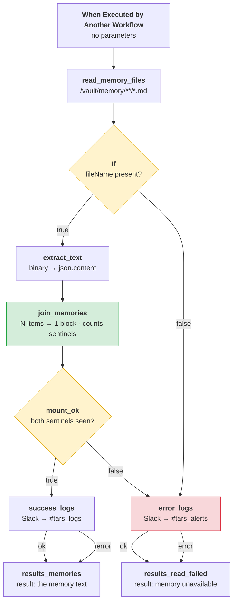

# memory_read

Reads every Markdown file in the agent's memory folders and returns them as one block of text. ⟦REVIEW⟧

A **sub-workflow** — no trigger of its own, never runs standalone. The AI agent calls it as a tool. ⟦REVIEW src:
workflow `memory_read`, Execute Workflow Trigger node⟧

## Why it exists

`memory_write` is the writing half. This is the reading half. Without it, facts go to disk and are never seen again —
the agent could save but not recall. ⟦REVIEW⟧

## Why it takes no parameters

No search string, no topic filter, no filename. This is deliberate. ⟦REVIEW⟧

The reported failure mode for small models is malformed *arguments*, not wrong tool selection. One published
function-calling harness moved Qwen models from a 6.75% first-try success rate to 99.8% by making invalid values
structurally impossible rather than by prompt tuning. A tool with no arguments has nothing to malform. ⟦REVIEW src:
typia.io, "Function Calling Harness: From 6.75% to 100%", read 2026-09-21⟧

A filter would also be actively harmful at this corpus size: a filter that misses is indistinguishable from an empty
memory store, so the agent would confidently report knowing nothing. Returning everything moves the filtering into the
model's reading comprehension, which is the task it is good at. ⟦REVIEW src: PLAN.md §Phase 1⟧

The narrowing path, when volume demands it, is in `PLAN.md` — a generated index at 30–100 files, embeddings past 100.
⟦REVIEW src: PLAN.md Phase 1 table⟧

## Flow



⟦REVIEW src: workflow `memory_read` canvas, read 2026-09-25⟧

Both branches end in a node returning a single `result` string, so the agent gets the same shape whichever path runs.
⟦REVIEW⟧

## What it reads

```
/vault/memory/**/*.md
```

`**` matches any folder depth, so one node covers both memory folders: ⟦REVIEW src: workflow `memory_read`,
read_memory_files node⟧

| Folder                   | Mount      | Holds                    |
|--------------------------|------------|--------------------------|
| `/vault/memory/briefing` | read-only  | facts you write by hand  |
| `/vault/memory/learned`  | writable   | facts the agent saved    |

The agent does not distinguish them, and should not — a fact is a fact regardless of who wrote it. ⟦REVIEW⟧

`*.md` rather than `*` keeps `.DS_Store` out of the result. ⟦REVIEW⟧

### Mount sentinels

Each folder carries one file that must always be present: ⟦REVIEW src: vault listing, 2026-09-25⟧

```
memory/briefing/_mount_check_briefing.md
memory/learned/_mount_check_learned.md
```

They exist so a **broken mount** can be told from an **empty memory store**. Without them the two are
indistinguishable — a failed bind mount, a wrong `VAULT_PATH`, or Docker silently creating an empty directory all
produce zero matches, exactly like a folder with nothing in it. The agent would then report that nothing is saved
while every memory sits safe on the host. ⟦REVIEW⟧

n8n has no way to ask whether a directory exists. The file node only globs, the Code node is sandboxed with no `fs`,
and `ExecuteCommand` is disabled by default in n8n 2.x. A file that must always match is the available substitute.
⟦REVIEW src: CLAUDE.md, Gotchas⟧

**One per mount, with different names.** `briefing` and `learned` are separate bind mounts and fail independently.
A single sentinel only proves its own folder is alive: with one in `briefing/` alone, losing that mount went unnoticed
because `learned/` still returned files. Distinct names stop either folder satisfying the other's check. ⟦REVIEW src:
docker-compose.yml, volumes block⟧

**Matched by full path, not by filename.** The glob flattens both folders into one list, and `fileName` carries no
folder with it. A stray copy of `_mount_check_briefing.md` sitting inside `learned/` would otherwise satisfy the
briefing check while `briefing/` was unmounted — the check passing while the thing it checks is broken. `join_memories`
records `${directory}/${name}`, so a sentinel only counts from its own mount. ⟦REVIEW src: workflow `memory_read`,
join_memories⟧

The agent cannot clobber the writable one. `memory_write` sanitises filenames with `replace(/[^a-z0-9-]/gi, '-')`, so
a leading underscore is structurally unreachable no matter what the model asks for — the same control that blocks path
traversal, doing a second job. ⟦REVIEW src: docs/memory_write.md, arrange_fields⟧

## Output

One field, `result`, in every case: ⟦REVIEW src: workflow `memory_read`, results_memories and results_empty⟧

| Case                        | `result`                                                    |
|-----------------------------|-------------------------------------------------------------|
| files found                 | each file as `### filename.md` followed by its full content  |
| both mounts alive, nothing saved | `no memories saved yet`                                |
| a mount is missing          | `memory unavailable: read failed`                            |

The last two are different facts and must not be conflated. "Nothing is saved" and "your memories cannot be reached"
lead the agent to opposite behaviour: the first is a normal state to report, the second means it should stop saving
until reads work again — saving blind means it cannot check for an existing filename, so it invents one. ⟦REVIEW src:
workflow `tars_agent`, system message⟧

The split is decided in two places. `join_memories` records which sentinels it saw and sets `mountOk`; the `mount_ok`
node routes on it. Reaching `results_read_failed` therefore has exactly one meaning — a mount is gone — so the node
returns a fixed string: ⟦REVIEW src: workflow `memory_read`, results_read_failed⟧

```
memory unavailable: read failed{{ $json.error ? ' (log failed)' : '' }}
```

`$json.error` here is **Slack's** error, not the read node's — the item arrives from `error_logs`. It appends
`(log failed)` so a silent logging failure still surfaces in the reply. ⟦REVIEW⟧

An earlier version inferred the failure from the error text instead, matching the exact string `No file(s) found`.
That was replaced because inference cannot see a *partial* failure: one folder unmounted while the other still returns
files produces no error at all. Counting sentinels is a check rather than a guess. ⟦REVIEW⟧

Frontmatter is passed through rather than stripped. `topic` and `summary` are free context for the model, and `created`
is what lets it prefer the newer of two contradictory memories. ⟦REVIEW⟧

The empty case returns a sentence, never an empty string. A model handed `""` fills the silence; handed a sentence, it
repeats the sentence. ⟦REVIEW⟧

## Nodes

### `read_memory_files` — Read/Write Files from Disk

Returns one item per file. The file's *description* goes into `json` — `fileName`, `mimeType`, `fileSize` — and its
*bytes* go into `binary.data`. The text is not readable at this point. ⟦REVIEW src: workflow `memory_read`, node output
inspected 2026-09-24⟧

```
On Error:            Continue (using regular output)
Always Output Data:  OFF
```

**This node never returns zero items.** A pattern matching nothing is reported as an error, not as an empty result:
⟦REVIEW src: node output for selector `/vault/memory/nope/**/*.md`, run 2026-09-24⟧

```json
{ "error": "No file(s) found" }
```

That single measured fact shapes the whole workflow. Two consequences: ⟦REVIEW⟧

- **`Always Output Data` is off.** It manufactures an empty item when a node returns none, which cannot happen here.
- **`On Error` is *regular* output, not error output.** With the error output enabled, a failed read left an item on
  the error exit *and* `Always Output Data` manufactured one on the normal exit — both branches fired on one run, two
  Slack cards, and the workflow's return value became a coin flip between "empty" and "unreachable". Routing everything
  down one exit removes the ambiguity. ⟦REVIEW src: execution with both branches lit, 2026-09-24⟧

An empty folder and a path outside `/vault` produce the *same* message, because n8n reports both as zero matches.
⟦REVIEW src: selectors `/vault/memory/nope/**/*.md` and `/etc/**/*.md`, both returning `No file(s) found`⟧ The error
text is therefore not a reliable way to tell "empty" from "broken" — which is why the mount sentinels exist and why
this branch now means only one thing. ⟦REVIEW⟧

### `If` — found or not

```
{{ $json.fileName !== undefined }}   is true
```

`fileName` exists only on a real file item; the error item has no such field. ⟦REVIEW src: workflow `memory_read`, If
node⟧

`!== undefined` rather than `!== null`: a property that was never set is `undefined`, and `undefined !== null` is
`true` — the empty case would have taken the true branch. ⟦REVIEW⟧

### `extract_text` — Extract from File

```
Operation:                 Extract From Text File
Input Binary Field:        data
Destination Output Field:  content
Keep Source:               Both
```

Adds `json.content` to the existing json and keeps the binary compartment. ⟦REVIEW src: workflow `memory_read`,
extract_text node⟧

**`Both` is required for the mount check, not for the text.** `json` carries `fileName`, `mimeType`, `fileType`,
`fileExtension` and `fileSize` — but **not the directory**. The folder a file came from exists only at
`binary.data.directory`. Set this to `JSON` and `join_memories` can no longer tell which mount a sentinel came from.
⟦REVIEW src: node output inspected 2026-09-25⟧

This was briefly set to `JSON` on the grounds that carrying file bytes was dead weight. Measured, that is about 150
bytes per memory file — roughly 4.5 KB at 30 files. Not a cost worth a weaker check. ⟦REVIEW⟧

### `join_memories` — Code, Run Once for All Items

Many items in, one item out. `Run Once for Each Item` cannot merge anything, because it never sees more than one item
at a time. ⟦REVIEW⟧

```js
const names = []; // Filenames for Slack, never see memory contents
const parts = []; // Part the Agent reads
const seen = new Set(); // Which mount sentinels turned up

// Loop every file item
for (const item of $input.all()) {
  /**
   * Get filename
   * ?? Supplies placeholder if really absent
   * Fact with no label -> still worth keeping
   */
  const name = item.json.fileName ?? 'unknown.md';

  // Folder lives in binary, not JSON. Needs Keep source: Both
  const dir = item.binary?.data?.directory ?? '';
  
  // Plumbing, not a memory. One per mount, both must appear.
  if (name.startsWith('_mount_check')) {
    seen.add(`${dir}/${name}`);
    continue;
  }

  /**
   * Get text extract_text produced
   * ?? '' since can't trim() undefined
   */
  const body = (item.json.content ?? '').trim();

  // Skip empty files, or else model treats it as fact went missing
  if (!body) continue;
  names.push(name); // Filename for Slack

  // ### tells model where one file ends and next begins
  parts.push(`### ${name}\n${body}`); // Get's passed to the Agent
}

/**
 * Both mounts must prove themselves, each with its own sentinel in its own folder.
 * A missing sentinel means that folder is not mounted, even when the other folder still returns files.
 */
const mountOk = seen.has('/vault/memory/briefing/_mount_check_briefing.md') && seen.has('/vault/memory/learned/_mount_check_learned.md');

/**
 * N8N always speaks in arrays of items, values always under JSON
 * parts.join() -> glue blocks with blank line between
 * parts.length ? -> covers an empty store, and files that exist but are blank
 * count and files -> For Slack only, Names only
 */
return [{
  json: {
    memories: parts.length ? parts.join('\n\n') : 'no memories saved yet',
    count: names.length,
    files: names.join(', '),
    mountOk
  }
}];
```

⟦REVIEW src: workflow `memory_read`, join_memories node⟧

Three baskets, each going somewhere different: `parts` is what the agent reads, `names` is what Slack shows, and
`seen` records which mount sentinels turned up. Memory contents are never logged. ⟦REVIEW⟧

`if (name.startsWith('_mount_check'))` records the sentinel and skips it, so it never reaches the agent as a fact. It
sits **before** the blank-body check, so an empty sentinel file still registers. ⟦REVIEW⟧

`mountOk` requires **both** sentinels — `&&`, not `||`. Either folder missing means that mount is gone, even when the
other still returns files. That asymmetric case is the one an error-text check could not see. ⟦REVIEW⟧

`if (!body) continue` skips blank files. A heading with nothing under it reads to the model like a fact that went
missing, and models fill gaps by guessing. ⟦REVIEW⟧

`parts.length ? … :` covers files that exist but are all blank — a case the `If` cannot catch, since those items do
have a `fileName`. ⟦REVIEW⟧

### Slack logging — two nodes

| Node                 | Colour             | Channel      | Fires when          |
|----------------------|--------------------|--------------|---------------------|
| `success_logs`       | green `#2eb886`    | `#tars_logs` | files returned      |
| `error_warning_logs` | amber `#e0a800`    | `#tars_logs` | nothing returned    |

Amber rather than red: an empty memory store is a normal state on day one, not a fault. Colour that cries wolf gets
ignored. ⟦REVIEW⟧

The amber card prints the raw `$json.error` rather than fixed text, so an unexpected failure shows its own message in
the same card instead of being described as "nothing saved yet". That is what replaces a dedicated red branch — a
branch that could not be triggered could not be verified either. ⟦REVIEW src: workflow `memory_read`,
error_warning_logs Blocks payload⟧

**`error_logs` is reached by two different routes**, and the card says which: ⟦REVIEW src: workflow `memory_read`,
error_logs Blocks payload⟧

| Route | `$json` carries | Card reads |
|---|---|---|
| `If` false | `error` | `Cause: read error` + the raw message |
| `mount_ok` false | `mountOk`, `count`, `files` | `Cause: missing mount sentinel` |

A read error does not prove a mount is missing, so the card must not claim it does. The two are distinguished by
whether `$json.error` is present. ⟦REVIEW⟧

`results_read_failed` deliberately returns **one** string for both. The agent's correct response is identical either
way — memory cannot be trusted, do not save anything new — so splitting the return value would add a distinction the
model cannot act on. The detail belongs in Slack, where you can act on it. ⟦REVIEW⟧

Both Slack nodes run `onError: continueErrorOutput` with **both outputs wired into the same result node**, so a Slack
outage cannot stop the agent receiving its memories. Logging never changes the answer. ⟦REVIEW src: workflow
`memory_read`, connections⟧

`success_logs` reports `count` and `files` — how many and which names. Never the contents. Memory text in a Slack
channel is a leak. ⟦REVIEW⟧

## What this does not cover

| Gap                                      | Where it lands                                                                     |
|------------------------------------------|------------------------------------------------------------------------------------|
| No filtering — every file, every call    | Deliberate below ~30 files; `PLAN.md` Phase 1 has the staged narrowing ⟦REVIEW⟧     |
| Stale duplicates are not detected        | `PLAN.md` Phase 1.5 — scheduled scan into `dashboard/stale_memories.md` ⟦REVIEW⟧    |
| A folder inside a live mount could be deleted unnoticed | The sentinels prove each *mount*. A subfolder removed from a mounted vault produces no error and no missing sentinel ⟦REVIEW⟧ |
| Contradictions between `briefing/` and `learned/` are not detected | `PLAN.md` Phase 1.5 — a scheduled cross-folder scan into `dashboard/stale_memories.md` ⟦REVIEW src: PLAN.md Phase 1.5⟧ |
| Context cost grows with file count       | At 16,384 tokens, watch it past ~30 files ⟦REVIEW src: CLAUDE.md, Gotchas⟧          |
