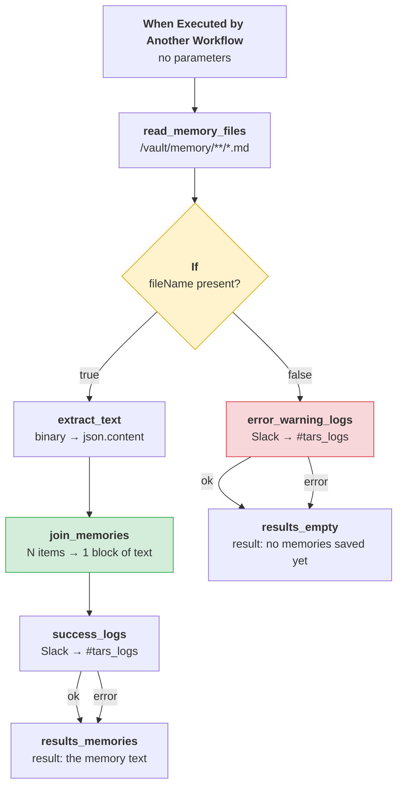

# memory_read

Reads every Markdown file in the agent's memory folders and returns them as one block of text. ⟦REVIEW⟧

A **sub-workflow** — no trigger of its own, never runs standalone. The AI agent calls it as a tool. ⟦REVIEW src:
workflow `memory_read`, Execute Workflow Trigger node⟧

## Why it exists

`memory_write` is the writing half. This is the reading half. Without it, facts go to disk and are never seen again —
the agent could save but not recall. ⟦REVIEW⟧

## Why it takes no parameters

No search string, no topic filter, no filename. This is deliberate. ⟦REVIEW⟧

The reported failure mode for small models is malformed *arguments*, not wrong tool selection. One published
function-calling harness moved Qwen models from a 6.75% first-try success rate to 99.8% by making invalid values
structurally impossible rather than by prompt tuning. A tool with no arguments has nothing to malform. ⟦REVIEW src:
typia.io, "Function Calling Harness: From 6.75% to 100%", read 2026-09-21⟧

A filter would also be actively harmful at this corpus size: a filter that misses is indistinguishable from an empty
memory store, so the agent would confidently report knowing nothing. Returning everything moves the filtering into the
model's reading comprehension, which is the task it is good at. ⟦REVIEW src: PLAN.md §Phase 1⟧

The narrowing path, when volume demands it, is in `PLAN.md` — a generated index at 30–100 files, embeddings past 100.
⟦REVIEW src: PLAN.md Phase 1 table⟧

## Flow



⟦REVIEW src: workflow `memory_read` canvas, read 2026-09-24⟧

Both branches end in a node returning a single `result` string, so the agent gets the same shape whichever path runs.
⟦REVIEW⟧

## What it reads

```
/vault/memory/**/*.md
```

`**` matches any folder depth, so one node covers both memory folders: ⟦REVIEW src: workflow `memory_read`,
read_memory_files node⟧

| Folder                   | Mount      | Holds                    |
|--------------------------|------------|--------------------------|
| `/vault/memory/briefing` | read-only  | facts you write by hand  |
| `/vault/memory/learned`  | writable   | facts the agent saved    |

The agent does not distinguish them, and should not — a fact is a fact regardless of who wrote it. ⟦REVIEW⟧

`*.md` rather than `*` keeps `.DS_Store` out of the result. ⟦REVIEW⟧

## Output

One field, `result`, in every case: ⟦REVIEW src: workflow `memory_read`, results_memories and results_empty⟧

| Case              | `result`                                                          |
|-------------------|-------------------------------------------------------------------|
| files found       | each file as `### filename.md` followed by its full content        |
| nothing found     | `no memories saved yet`                                            |

Frontmatter is passed through rather than stripped. `topic` and `summary` are free context for the model, and `created`
is what lets it prefer the newer of two contradictory memories. ⟦REVIEW⟧

The empty case returns a sentence, never an empty string. A model handed `""` fills the silence; handed a sentence, it
repeats the sentence. ⟦REVIEW⟧

## Nodes

### `read_memory_files` — Read/Write Files from Disk

Returns one item per file. The file's *description* goes into `json` — `fileName`, `mimeType`, `fileSize` — and its
*bytes* go into `binary.data`. The text is not readable at this point. ⟦REVIEW src: workflow `memory_read`, node output
inspected 2026-09-24⟧

```
On Error:            Continue (using regular output)
Always Output Data:  OFF
```

**This node never returns zero items.** A pattern matching nothing is reported as an error, not as an empty result:
⟦REVIEW src: node output for selector `/vault/memory/nope/**/*.md`, run 2026-09-24⟧

```json
{ "error": "No file(s) found" }
```

That single measured fact shapes the whole workflow. Two consequences: ⟦REVIEW⟧

- **`Always Output Data` is off.** It manufactures an empty item when a node returns none, which cannot happen here.
- **`On Error` is *regular* output, not error output.** With the error output enabled, a failed read left an item on
  the error exit *and* `Always Output Data` manufactured one on the normal exit — both branches fired on one run, two
  Slack cards, and the workflow's return value became a coin flip between "empty" and "unreachable". Routing everything
  down one exit removes the ambiguity. ⟦REVIEW src: execution with both branches lit, 2026-09-24⟧

An empty folder and a path outside `/vault` produce the *same* message, because n8n reports both as zero matches. They
are therefore not distinguishable, and the workflow does not pretend otherwise. ⟦REVIEW src: selectors
`/vault/memory/nope/**/*.md` and `/etc/**/*.md`, both returning `No file(s) found`⟧

### `If` — found or not

```
{{ $json.fileName !== undefined }}   is true
```

`fileName` exists only on a real file item; the error item has no such field. ⟦REVIEW src: workflow `memory_read`, If
node⟧

`!== undefined` rather than `!== null`: a property that was never set is `undefined`, and `undefined !== null` is
`true` — the empty case would have taken the true branch. ⟦REVIEW⟧

### `extract_text` — Extract from File

```
Operation:                 Extract From Text File
Input Binary Field:        data
Destination Output Field:  content
Keep Source:               JSON
```

Adds `json.content` to the existing json. `Keep Source: JSON` drops the binary compartment, which nothing downstream
needs — `fileName` is already in json. Carrying file bytes past this point would be dead weight on every item.
⟦REVIEW src: workflow `memory_read`, extract_text node⟧

### `join_memories` — Code, Run Once for All Items

Many items in, one item out. `Run Once for Each Item` cannot merge anything, because it never sees more than one item
at a time. ⟦REVIEW⟧

```js
const names = [];
const parts = [];

for (const item of $input.all()) {
  const name = item.json.fileName ?? 'unknown.md';
  const body = (item.json.content ?? '').trim();
  if (!body) continue;
  names.push(name);
  parts.push(`### ${name}\n${body}`);
}

return [{
  json: {
    memories: parts.length ? parts.join('\n\n') : 'no memories saved yet',
    count: names.length,
    files: names.join(', ')
  }
}];
```

⟦REVIEW src: workflow `memory_read`, join_memories node⟧

Two baskets rather than one, because they go to different places: `parts` is what the agent reads, `names` is what
Slack shows. Memory contents are never logged. ⟦REVIEW⟧

`if (!body) continue` skips blank files. A heading with nothing under it reads to the model like a fact that went
missing, and models fill gaps by guessing. ⟦REVIEW⟧

`parts.length ? … :` covers files that exist but are all blank — a case the `If` cannot catch, since those items do
have a `fileName`. ⟦REVIEW⟧

### Slack logging — two nodes

| Node                 | Colour             | Channel      | Fires when          |
|----------------------|--------------------|--------------|---------------------|
| `success_logs`       | green `#2eb886`    | `#tars_logs` | files returned      |
| `error_warning_logs` | amber `#e0a800`    | `#tars_logs` | nothing returned    |

Amber rather than red: an empty memory store is a normal state on day one, not a fault. Colour that cries wolf gets
ignored. ⟦REVIEW⟧

The amber card prints the raw `$json.error` rather than fixed text, so an unexpected failure shows its own message in
the same card instead of being described as "nothing saved yet". That is what replaces a dedicated red branch — a
branch that could not be triggered could not be verified either. ⟦REVIEW src: workflow `memory_read`,
error_warning_logs Blocks payload⟧

Both nodes run `onError: continueErrorOutput` with **both outputs wired into the same result node**, so a Slack outage
cannot stop the agent receiving its memories. Logging never changes the answer. ⟦REVIEW src: workflow `memory_read`,
connections⟧

`success_logs` reports `count` and `files` — how many and which names. Never the contents. Memory text in a Slack
channel is a leak. ⟦REVIEW⟧

## What this does not cover

| Gap                                      | Where it lands                                                                     |
|------------------------------------------|------------------------------------------------------------------------------------|
| No filtering — every file, every call    | Deliberate below ~30 files; `PLAN.md` Phase 1 has the staged narrowing ⟦REVIEW⟧     |
| Stale duplicates are not detected        | `PLAN.md` Phase 1.5 — scheduled scan into `dashboard/stale_memories.md` ⟦REVIEW⟧    |
| Read failures are indistinguishable from an empty store | n8n reports both as `No file(s) found`; the raw message is surfaced in Slack ⟦REVIEW⟧ |
| Context cost grows with file count       | At 16,384 tokens, watch it past ~30 files ⟦REVIEW src: CLAUDE.md, Gotchas⟧          |
