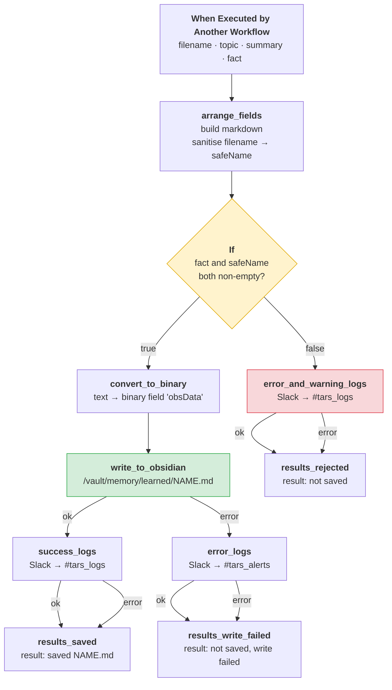
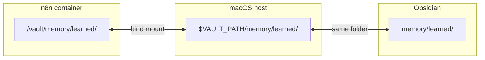

# memory_write

Saves one fact as one Markdown file in the agent's memory folder. ⟦REVIEW⟧

A **sub-workflow** — no trigger of its own, never runs standalone. The AI agent calls it as a tool. ⟦REVIEW src:
workflow `memory_write`, Execute Workflow Trigger node⟧

## Why it exists

A language model has no memory between conversations. What looks like memory is the transcript being pasted back in;
close the chat and it is gone. ⟦REVIEW⟧

Durable memory means writing facts to disk and reading them back later. This workflow is the writing half. ⟦REVIEW⟧

## Why it is a separate workflow

`Read/Write Files from Disk` reports `isAITool: false` — there is no Tool variant. ⟦REVIEW src: n8n-mcp `get_node` for
`nodes-base.readWriteFile`, run 2026-09-20⟧ An AI Agent can only attach nodes that are tools, so the only route is to
wrap the capability in a workflow and attach it with **Call n8n Workflow Tool**. ⟦REVIEW⟧

It also narrows what the model can get wrong: the agent sees four named fields and never sees a filesystem path.
⟦REVIEW⟧

## Flow



⟦REVIEW src: workflow `memory_write` canvas, read 2026-09-20⟧

Both branches end in a node that returns a single `result` string, so the agent gets the same shape whichever path runs.
⟦REVIEW⟧

## Where the file lands

The container and the host see the same folder under two names, via the bind mount. ⟦REVIEW src: docker-compose.yml,
volumes block⟧



`N8N_RESTRICT_FILE_ACCESS_TO=/vault` is what permits writing there. ⟦REVIEW src: docker-compose.yml, environment block⟧

## Inputs

Declared on the trigger with **Input data mode: Define using fields below**. These names are the tool's public
interface — what the agent fills in. ⟦REVIEW⟧

| Field      | Type   | Contents                                           |
|------------|--------|----------------------------------------------------|
| `filename` | String | kebab-case, no extension — `oracle-server-address` |
| `topic`    | String | one word — `servers`, `personal`, `work`           |
| `summary`  | String | one line describing the fact                       |
| `fact`     | String | the thing to remember                              |

`fact` rather than `content`: a small model reads parameter names when deciding what goes where, and "content" is
ambiguous. ⟦REVIEW⟧

No date field. `arrange_fields` stamps it from `$now` — asking a model for today's date returns one from its training
data. ⟦REVIEW⟧

## Output

One field, either way. ⟦REVIEW⟧

```
saved: oracle-server-address.md
not saved: fact was empty or filename unusable
not saved: write to disk failed
```

Whatever the last node outputs is what the caller receives. Without a fixed shape the true branch would return file
metadata and the false branch a Slack API response — and the agent would report success either way. ⟦REVIEW⟧

## Nodes

### `arrange_fields` — Edit Fields

Adds **three** computed fields — `markdown`, `safeName`, `safeTopic` — and passes the original four through (**Include Other Input Fields: ON**). ⟦REVIEW src: workflow `memory_write`, arrange_fields node⟧

`topic` is **normalised, not validated**. The expression trims and lowercases the incoming value, accepts it only if it is one of `servers`, `personal`, `work`, `tools`, `general`, and maps anything else to `general`: ⟦REVIEW⟧

```
{{ ['servers','personal','work','tools','general'].includes(($json.topic || '').toLowerCase().trim()) ? ($json.topic || '').toLowerCase().trim() : 'general' }}
```

Normalising rather than rejecting is deliberate — a topic the model got wrong should not stop a real fact being saved. The same expression is inlined into the `markdown` field and also stored as `safeTopic`, because fields inside one Set node cannot reference each other; `safeTopic` exists for the Slack nodes, which read it from a different node. ⟦REVIEW⟧

**`markdown`** — the file body:

```
---
created: {{ $now.toISODate() }}
source: inferred
topic: "{{ ($json.topic || '').replace(/[\r\n]+/g, ' ').replace(/"/g, "'") }}"
summary: "{{ ($json.summary || '').replace(/[\r\n]+/g, ' ').replace(/"/g, "'") }}"
---

{{ $json.fact }}
```

`source: inferred` is hardcoded — everything this workflow writes was saved by the agent. Facts written by hand into
`memory/briefing/` are `stated`. The model never supplies this field, so it cannot get it wrong. ⟦REVIEW⟧

**`safeName`** — the sanitised filename:

```
{{ ($json.filename || '').replace(/[^a-z0-9-]/gi, '-').toLowerCase().slice(0, 60) }}
```

A security control, not formatting. `filename` is generated by a language model and pasted into a filesystem path.
Unsanitised, a value of `../../home/node/.n8n/config` resolves to the n8n config file, which holds the encryption key.
⟦REVIEW src: docker-compose.yml, `n8n_data:/home/node/.n8n` volume⟧

| Part             | Why                                                                                              |
|------------------|--------------------------------------------------------------------------------------------------|
| `[^a-z0-9-]`     | *not* a–z, 0–9 or hyphen — dots and slashes cannot survive, so the path cannot escape the folder |
| `.toLowerCase()` | macOS filesystems are case-insensitive; keeps collisions predictable                             |
| `.slice(0, 60)`  | filesystem name limits, and keeps names readable                                                 |
| `\|\| ''`        | guards `undefined`, which would make `.replace()` throw instead of routing to the false branch   |

No fallback name by design. An earlier version used `|| 'untitled'`, which produced a non-empty `safeName`, passed
validation, and silently wrote `untitled.md` instead of rejecting. ⟦REVIEW⟧

### `If` — validation gate

Combinator **AND**; both must pass. ⟦REVIEW⟧

| Left                      | Operator     | Catches                                                                                                      |
|---------------------------|--------------|--------------------------------------------------------------------------------------------------------------|
| `{{ $json.fact.trim() }}` | is not empty | whitespace-only facts, which pass a plain empty check                                                        |
| `{{ $json.safeName }}`    | is not empty | a `filename` that sanitises to nothing, which would write a file named `.md` — hidden from `ls` and Obsidian |
| `{{ $json.safeName.replace(/-/g, '') }}` | is not empty | punctuation-only input such as `../../`, which sanitises to `------` and would otherwise pass |

### `convert_to_binary` — Convert to File

Operation **Convert to Text File**, Text Input Field `markdown`, output binary field `obsData`, **File Name** option
`{{ $json.safeName }}`. ⟦REVIEW src: workflow `memory_write`, Convert to File node⟧

Exists because the write node takes binary, not text. Every n8n item has a `json` compartment and a `binary`
compartment; this moves a string between them. ⟦REVIEW src: n8n-mcp `get_node` for `nodes-base.convertToFile`, required
property `binaryPropertyName`⟧

### `write_to_obsidian` — Read/Write Files from Disk

Operation **Write File to Disk**, Input Binary Field `obsData`. ⟦REVIEW⟧

```
/vault/memory/learned/{{ $binary.obsData.fileName }}.md
```

The name is read back from the binary rather than recomputed, so `convert_to_binary` owns naming and there is one source
of truth. Trade-off: remove the **File Name** option there and this node silently writes `.md` again, with no error.
⟦REVIEW⟧

### Slack logging — three nodes

| Node | Colour | Channel | Fires when |
|---|---|---|---|
| `success_logs` | `#2eb886` green | `#tars_logs` | a file was written |
| `error_and_warning_logs` | `#e0a800` amber | `#tars_logs` | validation rejected the input |
| `error_logs` | `#dc3545` red | `#tars_alerts` | the disk write threw |

Write failures go to `#tars_alerts` rather than `#tars_logs` — a failed write means the memory system is broken, not merely refusing bad input. That is the urgency split the two channels exist for. ⟦REVIEW⟧

**Every Slack node runs with `onError: continueErrorOutput`, and both of its outputs land on the same result node.** So a Slack outage cannot stop the caller receiving a result. Logging must never be able to change the answer. ⟦REVIEW src: workflow `memory_write`, connections⟧

`results_saved` and `results_rejected` append ` (log failed)` when `$json.error` is present, so a silent logging failure still surfaces in the agent's reply. Without that, a wrong channel ID fails invisibly — which happened once during development and was only caught by accident. ⟦REVIEW⟧

**Message format uses an undocumented wrapper.** n8n's Blocks field states the payload must be `{ "blocks": [...] }`, but it also accepts `{ "attachments": [{ "color": ..., "blocks": [...] }] }`. That is the only way to get a coloured strip — Block Kit has no colour property, and n8n's own Attachments message type is flagged as legacy and cannot contain blocks. ⟦REVIEW src: n8n-mcp `get_node` for `nodes-base.slack`, blocksUi description; verified by execution 2026-09-21⟧

Every model-supplied value inside the payload is wrapped in `JSON.stringify(...).slice(1, -1)`. A double quote in `summary` or `filename` would otherwise break the JSON and the node would fail to parse — the same class of problem as the YAML escaping above, different format. ⟦REVIEW⟧

The rejection message reads: ⟦REVIEW src: workflow `memory_write`, Slack node, Channel By
ID⟧

```
:warning: *[memory_write]* rejected
> filename: {{ $('arrange_fields').item.json.filename }}
> topic: {{ $('arrange_fields').item.json.topic }}
> reason: empty fact or unusable filename
```

The workflow name in brackets is what keeps a single shared log channel usable as more workflows are added. ⟦REVIEW⟧

## Slack setup

App **T.A.R.S**, created from a manifest with two bot scopes: `chat:write` and `channels:read`. ⟦REVIEW src: Slack app
manifest for T.A.R.S, created 2026-09-20⟧

n8n's official manifest requests seventeen scopes including `channels:history` and `im:history`, which grant read access
to every message in every channel the bot joins. TARS only posts, so those are not granted. ⟦REVIEW src: n8n Slack
credentials documentation, app manifest section⟧

Credential type is **Slack API (Access Token)**, not OAuth2 — OAuth2 needs a redirect URL Slack can reach, and n8n is
bound to `127.0.0.1:5678`. ⟦REVIEW src: docker-compose.yml, ports mapping⟧

**Signature Secret** is left blank. It verifies *inbound* requests from Slack, which only matters for the Slack Trigger
node. ⟦REVIEW src: Slack documentation, verifying requests from Slack⟧

## What this does not cover

Write failures **are** handled: `write_to_obsidian` runs with **On Error → Continue (using error output)**, and that
output reaches `results_write_failed`. Slack does the same, so a notification failure cannot stop `results_rejected`
from returning. ⟦REVIEW src: workflow `memory_write`, `onError: continueErrorOutput` on both nodes⟧

Still open:

| Gap                       | Why it matters                                                                                                                                   |
|---------------------------|--------------------------------------------------------------------------------------------------------------------------------------------------|
| Duplicate filenames       | Saving the same `filename` twice overwrites the earlier file with no warning. ⟦REVIEW⟧                                                           |
| Stale facts               | Nothing detects a saved fact that stopped being true — the documented cost of markdown-file memory. The `created` field is the date half of the fix; the revalidation half is Phase 1.5 in `PLAN.md`. ⟦REVIEW src: PLAN.md §3.5 and Phase 1.5⟧ |
| Reading memory back       | That is `memory_read`, not yet built. ⟦REVIEW⟧                                                                                                   |
| Shared Slack notification | Three Slack nodes now live inline in this workflow, each with its own channel ID and payload. The threshold for extracting a shared `tars_notify` sub-workflow has effectively been reached. ⟦REVIEW src: workflow `memory_write`, three Slack nodes⟧ |
