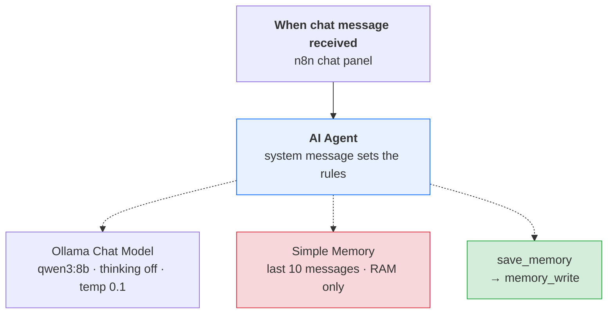

# tars_agent

The production assistant. Everything else in this repository exists to serve it. ⟦REVIEW⟧

`test_chat_LLM` remains a learning scaffold and is not part of this. ⟦REVIEW src: docs/test_workflows.md⟧

## Shape



⟦REVIEW src: workflow `tars_agent`, read 2026-09-21⟧

Dotted lines are sub-node connections — the model, memory and tools hang under the agent rather than passing data along a chain. ⟦REVIEW⟧

## Two kinds of memory

Not alternatives. Each does a job the other cannot. ⟦REVIEW⟧

| | Simple Memory | `memory_write` files |
|---|---|---|
| Holds | the last 10 messages | facts chosen deliberately |
| Lives in | RAM | the Obsidian vault |
| Survives a restart | no | yes |
| Should it? | **no** | **yes** |

Simple Memory forgetting is correct behaviour. Last week's chatter in today's context is expensive noise on a 16,384-token budget, and the entire prior conversation is re-sent with every message. ⟦REVIEW src: docs/test_workflows.md, agent run section⟧

The filtering step is the tool call: whatever is worth keeping gets written to a file. ⟦REVIEW⟧

**Context Window Length is 10** — enough to follow a conversation, small enough to leave room for memory files once `memory_read` is attached. ⟦REVIEW src: workflow `tars_agent`, Simple Memory node⟧

Persistent chat memory exists in n8n as Postgres and Redis sub-nodes. Neither is running; swapping the node is a five-minute change and arrives with Phase 5. ⟦REVIEW src: PLAN.md Phase 5⟧

## Model settings

```
model:        qwen3:8b
think:        false
temperature:  0.1
```

⟦REVIEW src: workflow `tars_agent`, Ollama Chat Model node⟧

Both non-default values come from measurement. Thinking mode took 4m 39s on one query; disabled, with proper tools and a system prompt, the same query took 20s and was correct. Tool calls are structured JSON, and a default chat temperature encourages the variation that breaks parsing. ⟦REVIEW src: docs/test_workflows.md, measured results⟧

Qwen's own guidance says thinking mode improves accuracy on complex multi-tool chains. True, and irrelevant here — one tool, one step, and four minutes is not a trade worth making. ⟦REVIEW src: Qwen function calling documentation, via WebSearch 2026-09-21⟧

## The system message

Without one, a local model does not reliably know when to use its tools. ⟦REVIEW src: CLAUDE.md, Agent configuration findings⟧

```
You are TARS, a personal assistant running locally.

You have a long-term memory. Use the save_memory tool ONLY when the user
explicitly asks you to remember, note, or save something. Never save
anything on your own initiative.

After saving, confirm what you saved in one short sentence. The tool
returns either "saved: ..." or "not saved: ...". If it reports a failure,
say so plainly, never claim something was saved when the tool says
otherwise.

Keep answers short and direct.
```

Two clauses are load-bearing: ⟦REVIEW⟧

**"ONLY when the user explicitly asks"** enforces the explicit-only decision. Automatic capture fills the store with small talk, corrections and misreadings, and that noise then pollutes every later answer. ⟦REVIEW src: PLAN.md §4, memory file format⟧

**The failure-reporting paragraph** exists because `memory_write` returns three distinct outcomes, and a model with no instruction will say "saved!" regardless of which one came back. ⟦REVIEW src: docs/memory_write.md, Output section⟧

## The `save_memory` tool

**Call n8n Sub-Workflow Tool**, typeVersion 2.2, pointed at `memory_write`. ⟦REVIEW src: workflow `tars_agent`, save_memory node⟧

On 2.2 there is no separate Name field — **the node name is the function name the model calls.** Hence `save_memory`, matching the name used in the system message. A default name like `Call 'memory_write'` would hand the model spaces, quotes, and a description of the file layout rather than of the decision. ⟦REVIEW src: n8n-mcp `get_node` for `nodes-langchain.toolWorkflow`, name property gated to version ≤ 2.1⟧

### Description — decides *whether* it gets called

```
Saves one fact to long-term memory so it can be recalled in future
conversations.

Call this ONLY when the user explicitly asks you to remember something.

Parameters:
- filename: short kebab-case id, lowercase letters and hyphens only,
  no file extension. Example: oracle-server-address
- topic: exactly one of servers, personal, work, tools, general.
  Use general if none fit.
- summary: one short line describing what the fact is about
- fact: the complete fact, written as a full sentence
```

### Per-parameter descriptions — decide *how each field is filled*

Each input is AI-fillable via `$fromAI(name, description, type)`. The second argument is filled on all four: ⟦REVIEW src: workflow `tars_agent`, save_memory workflowInputs⟧

| Parameter | Description given to the model |
|---|---|
| `filename` | short kebab-case id, lowercase letters and hyphens only, no extension, e.g. oracle-server-address |
| `topic` | exactly one of: servers, personal, work, tools, general. Pick general if none fit |
| `summary` | one short line describing what the fact is about |
| `fact` | the complete fact, written as a full sentence |

Both layers are needed, and they answer different questions. ⟦REVIEW⟧

This is the closest available substitute for schema-level constraints. A published function-calling harness moved Qwen models from a 6.75% first-try success rate to 99.8% by making invalid values structurally impossible rather than by prompt tuning — not reproducible in n8n's UI, so the shape is described with an example instead. ⟦REVIEW src: typia.io, "Function Calling Harness: From 6.75% to 100%", read 2026-09-21⟧

**`topic` is a closed set for the same reason.** An early save chose `personal` for a server address while `servers` was offered as an example. Free-text fields drift; a closed list with an escape hatch does not. `memory_write` normalises anything unrecognised to `general` rather than rejecting the save. ⟦REVIEW src: docs/memory_write.md, arrange_fields⟧

## Measured behaviour

Three tests against `qwen3:8b`: ⟦REVIEW src: workflow executions run 2026-09-21⟧

| Input | Tool called | Result | Time |
|---|---|---|---|
| "remember that my Oracle Box is at 10.0.0.42" | yes | all four parameters correctly formatted, file written | 16.0s |
| "remember that my home server runs Proxmox" | yes | `topic: servers` | — |
| "what's the weather like today?" | **no** | answered directly | 10.5s |

The first test settled the largest open question in the design: **an 8B model can fill four tool parameters reliably.** Published guidance places the comfortable tool-calling tier at 22B and above, so this was not a given. ⟦REVIEW src: PLAN.md §3.3⟧

The third test matters as much. Without the explicit-only clause the agent would save every passing remark, and the store would be worthless within a week. ⟦REVIEW⟧

A tool call costs two model invocations — one to choose the tool, one to phrase the reply — visible as two `Ollama Chat Model` entries in the execution log. 379 tokens with the call, 141 without. ⟦REVIEW src: execution logs, 2026-09-21⟧

## What this does not do yet

| Gap | Where it lands |
|---|---|
| Cannot read memory back | `memory_read`, not yet built ⟦REVIEW⟧ |
| Chat only in n8n's panel | Phase 3 replaces the trigger with Slack, once n8n is reachable from outside ⟦REVIEW src: PLAN.md Phase 3⟧ |
| Conversation lost on restart | Postgres or Redis chat memory, Phase 5 ⟦REVIEW src: PLAN.md Phase 5⟧ |
| One tool only | Deliberate — the plan caps an agent at one or two tools before splitting ⟦REVIEW src: PLAN.md §4⟧ |
