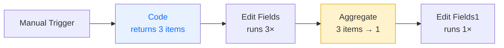
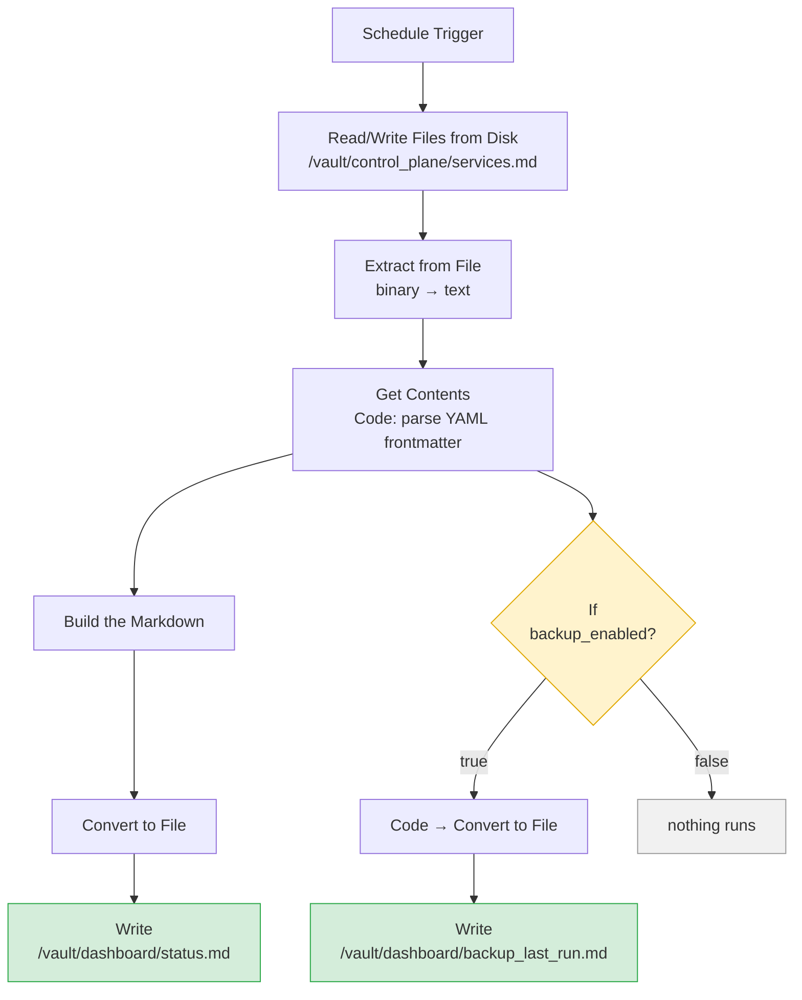
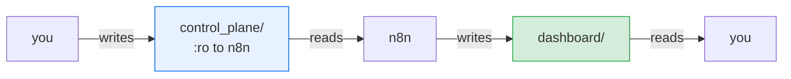
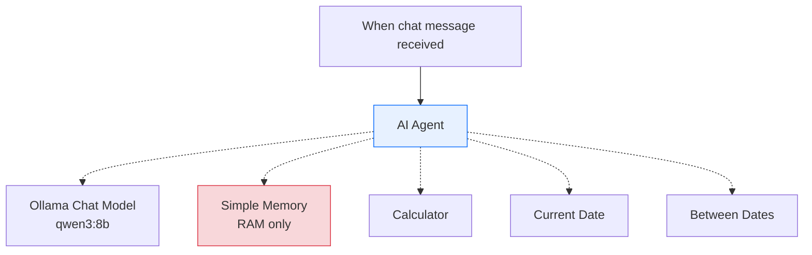
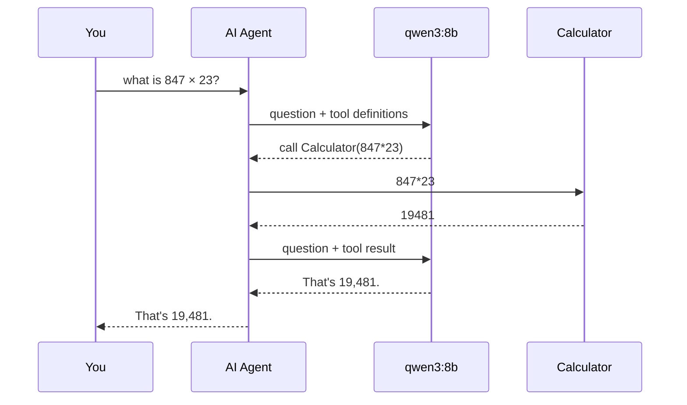

# Test Workflows

Learning scaffolds, not production automation. The switches here control nothing real — `backup_enabled` gates a
workflow that only writes a timestamp, because there is no backup. They are kept as working references for patterns
reused in real workflows. ⟦REVIEW⟧

Exports live in [`n8n_workflows/`](../n8n_workflows). For a production example, see [
`memory_write.md`](memory_write.md). ⟦REVIEW src: repository directory listing⟧

---

## `test_nodes_and_obsidian`

Two independent sections on one canvas, grouped with sticky notes. Each has its own trigger, and n8n only runs the
branch belonging to the trigger that fired. ⟦REVIEW⟧

### Section A — the data model



⟦REVIEW src: workflow `test_nodes_and_obsidian`, Section A⟧

The point of this chain is that **the item count changes shape partway through**. ⟦REVIEW⟧

| Concept                                                                | Where it shows up                                                            |
|------------------------------------------------------------------------|------------------------------------------------------------------------------|
| Every node receives and returns an **array of items**                  | the Code node returns three `{ json: {...} }` objects                        |
| Most nodes **run once per item**                                       | Edit Fields executes three times; `$json` means *the current item*           |
| Expressions are real JavaScript                                        | `{{ $json.years >= 5 ? 'senior' : 'junior' }}`                               |
| **Include Other Input Fields** decides whether upstream fields survive | off by default — the usual cause of fields "disappearing" mid-workflow       |
| Some nodes **collapse many items into one**                            | Aggregate turns 3 items into 1, nesting them under a configurable field name |
| Reaching a node that isn't feeding you                                 | `{{ $('Edit Fields').first().json.name }}`                                   |

After Aggregate the shape changes, so `$json.name` becomes undefined and the data lives at
`$json.<output field>[0].name`. The aggregated value is a plain JavaScript array, so `map`, `filter` and `join` work on
it directly. ⟦REVIEW⟧

### Section B — the control-plane pattern



⟦REVIEW src: workflow `test_nodes_and_obsidian`, Section B⟧

Who writes where: ⟦REVIEW⟧



**Two writers are never pointed at one file.** `control_plane/` is written only by a human, `dashboard/` only by n8n.
That is what makes this safe to put through git without merge conflicts — and it is the same rule `memory/briefing` and
`memory/learned` follow. ⟦REVIEW src: docker-compose.yml, volumes block⟧

**The switch lives in YAML frontmatter**, not a markdown table. Obsidian renders boolean frontmatter as a real checkbox
in its Properties panel, so flipping a switch is a click — while on disk it is a one-word change n8n can read without
parsing markdown. ⟦REVIEW⟧

```yaml
---
backup_enabled: true
daily_summary_enabled: false
---
```

Set values explicitly. An empty YAML value parses as `null`, not `false`, so a switch that looks off does not behave as
off. ⟦REVIEW⟧

**The frontmatter parser is hand-rolled** in `Get Contents`. n8n 2.x blocks Code nodes from importing external modules
by default, so `js-yaml` is unavailable without widening `NODE_FUNCTION_ALLOW_EXTERNAL`. It handles flat `key: value`
pairs only — a reasonable constraint, since nested YAML would be unpleasant to edit in Obsidian's Properties panel
anyway. ⟦REVIEW⟧

**The IF node is the point of the exercise.** With the switch off, the nodes after the `true` branch show zero
executions while the status chain still runs. A toggle in a text editor causing a node not to execute is the whole
control-plane idea in one observation. ⟦REVIEW⟧

Each output file needs its own Convert + Write pair. One Write node means one destination path — sharing it makes the
second branch overwrite the first. ⟦REVIEW⟧

---

## `test_chat_LLM`



⟦REVIEW src: workflow `test_chat_LLM`⟧

Dotted lines are **sub-node connections** — the model, memory and tools attach underneath the agent rather than passing
data along a chain. ⟦REVIEW⟧

### What an agent run actually looks like



⟦REVIEW src: execution logs observed in this workflow⟧

The model is called **once per decision**, not once per question. A single tool use means two model calls. Latency
scales with the number of tool calls, which is the practical argument for keeping tools per agent low. ⟦REVIEW⟧

Memory is not clever — the entire prior conversation is re-sent with every message. Token counts grow accordingly, and
Simple Memory holds it in RAM, so a container restart clears it. That limitation is what `memory_write` exists to solve.
⟦REVIEW⟧

### Measured results

Same question, same tools, varying configuration: ⟦REVIEW src: workflow executions run 2026-09-13 and 2026-09-14⟧

| Configuration                                          | Result           | Time       |
|--------------------------------------------------------|------------------|------------|
| llama3.1:8b, defaults, tool with no AI-fillable params | wrong            | ~19s       |
| Gemini, same broken tool                               | correct          | ~17s       |
| qwen3:8b, thinking **on**, no system prompt            | correct, by luck | **4m 39s** |
| qwen3:8b, thinking **off**, no system prompt           | badly wrong      | 13s        |
| qwen3:8b, thinking off + proper tools + system prompt  | **correct**      | 20s        |

**Configuration materially affected the qwen3 results.** Three changes moved qwen3:8b from unreliable to
correct: ⟦REVIEW⟧

1. **Tool parameters marked AI-fillable** (the sparkle icon). Without them a tool is a fixed button the agent cannot
   steer, so it guesses instead.
2. **A System Message that mandates tool use** — "always use the Calculator for arithmetic, never calculate in your
   head".
3. **Distinct tool names.** Two tools both called "Date & Time" produced ambiguous selection; renaming to "Current Date"
   and "Between Dates" resolved it.

Settings that matter for local models: **Enable Thinking off**, **Sampling Temperature 0.1**. Tool calls are structured
JSON, and a default chat temperature encourages the variation that breaks parsing. ⟦REVIEW⟧

These rows do not isolate model from configuration — the qwen3 rows vary configuration within one model, while
the llama3.1 and Gemini rows vary the model against the same broken tool. Read them as evidence that configuration
matters, not as a ranking of model against configuration. When an agent misbehaves, suspect the tool
definitions and system prompt first. ⟦REVIEW⟧

---

## What these do not cover

Postgres, persistent memory across restarts, webhooks, queue mode, and anything requiring a public address. Those arrive
with the move to Oracle Cloud. ⟦REVIEW src: README.md, Roadmap Phase 2⟧
